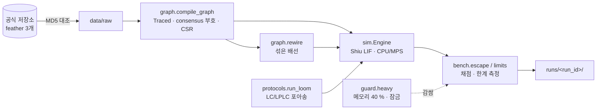

# fly-connectome-closed-loop — core 구현 플랜 (P) · A 단계 시뮬레이터 코어

## 헤더

- **요구사항**: 3340 — [./20260921-233859-3340_fly-connectome-closed-loop_req.md](./20260921-233859-3340_fly-connectome-closed-loop_req.md)
- **인터페이스 계약(I)**: [./20260921-233859-3340_fly-connectome-closed-loop_interface-design.md](./20260921-233859-3340_fly-connectome-closed-loop_interface-design.md) (승인 v2 · G2 위임)
- **모듈**: core — 저장소 `GitHub/moai-echomind-fly-connectome` 의 A 단계(`data` · `graph` · `sim` · `protocols` · `bench` · `runs` · `guard`)
- **작성일**: 2026-09-22 00:23:49
- **Goal**: 공식 MaleCNS 파일로 뇌 전체(Traced 165,122) Shiu LIF 가 맥에서 돌고, 도망 반사 채점을 통과하며 섞은 배선 대조군은 침묵한다.
- **Architecture**:

- **Tech Stack**: Python 3.14.7(uv) · torch 2.14.0(CPU·MPS) · numpy 2.5 · pyarrow 25.0 · pyyaml · pytest · ruff · brian2 2.10.1(시험 전용)
- **선행 P 의존성**: 없음(첫 P)

> ⚠️ 이 P 는 요구자 위임(*"변경이 필요하면 변경해서 구현해봐"*)으로 **구현과 같은 흐름에서** 쓰였다. 코드 블록 대신
> 저장소 커밋 `1c58688` 의 해당 파일 전체가 코드 정본이고, 이 문서는 **순서와 검증 절차**를 적는다.

---

## Task 1: 저장소와 설정

- [x] Step 1 — 저장소 뼈대 · `pyproject.toml`(3.14 · hatchling · ruff 100) · `.gitignore`(data · runs) · `NOTICE`(출처) · `README.md`(용어)
- [x] Step 2 — `config/sources.yaml`(공식 MD5 — GCS JSON API 조회값) · `sim.yaml`(Shiu 값 + 출처) · `loom.yaml`(Turner 2022 상대 세기) · `guard.yaml`

**Files**: `pyproject.toml` · `.gitignore` · `NOTICE` · `README.md` · `config/*.yaml` · `src/moai_echomind_fly/{paths,config,guard}.py`

- Run: `uv venv --python 3.14.7 .venv && uv sync --group dev`
- Expected: `import torch, pyarrow, mcp, brian2` 성공 · `torch.backends.mps.is_available() == True`

## Task 2: 데이터 받기 (F-001)

**Files**: `src/moai_echomind_fly/data.py` · `tests/test_data_verify.py`

- [x] 크기 · 공식 MD5 대조 · `.part` 에 받고 통과한 것만 제자리로 · SHA-256 을 `data/raw/SHA256SUMS` 에
- Run: `uv run fly-connectome download`
- Expected: 파일 3개 "공식 MD5 일치" · 두 번째 실행은 받지 않음

## Task 3: 그래프 (F-002)

**Files**: `src/moai_echomind_fly/graph.py` · `tests/test_graph_data.py`

- [x] Traced 고르기 · consensus_nt 부호(히스타민 −) · 연결 스트리밍 · 출발 순 정렬(CSR) · 메타데이터 · 섞은 배선(도착 순열)
- Run: `uv run fly-connectome graph --rewired-seed 0`
- Expected: 뉴런 165,122 · 연결 25,563,197 · 부호 − 57,261 · NT 행 없음 502 · 케니언 세포 4,064 전부 +

## Task 4: LIF 엔진 (F-003)

**Files**: `src/moai_echomind_fly/sim.py` · `tests/test_sim_parity.py`

- [x] Brian2 일정 순서(갱신 → 문턱 → 전달 → 리셋) · 선형 식 정확한 해 · 1.8 ms 지연 대기열 · 발화한 뉴런의 CSR 구간만 전달 · 포아송 사건표 미리 생성
- [x] **불응 중인 뉴런에 도착한 입력은 버린다**(Brian2 조건부 쓰기 — 대조 시험에서 찾음)
- Run: `uv run pytest tests/test_sim_parity.py`
- Expected: Brian2 판과 발화 (스텝, 뉴런) 목록이 **완전히 같다** · 자극 없으면 발화 0 · 침묵 · 같은 씨앗 같은 결과

## Task 5: 도망 반사 채점 (F-004) · 한계 측정 (F-005) · 실행 기록 (F-007)

**Files**: `src/moai_echomind_fly/{protocols,runs}.py` · `src/moai_echomind_fly/bench/{cli,escape,limits}.py` · `tests/test_escape_replay.py`

- [x] `w_scale` 은 결과를 보기 전에 적은 규칙(`escape.FIT_RULE` fit-v1)으로만 고른다
- Run: `uv run fly-connectome bench fit` → Expected: 통과 구간의 가운데 값(둘이면 작은 쪽)
- Run: `uv run fly-connectome bench escape --trials 40` → Expected: 다섯 항목 통과(섞은 배선 포함)
- Run: `uv run fly-connectome bench limits` → Expected: 세 결과가 `runs/<id>/summary.json` 에 기록
- Run: `uv run pytest tests/test_escape_replay.py` → Expected: 기록으로 재실행한 발화 = 원래 발화

## 최종 검증

- Run: `uv run pytest` · `uv run ruff check src tests`
- Expected: 전부 통과 · 검사 통과 → W 작성 · R 4.4 갱신
