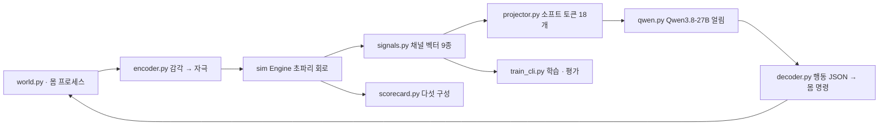

# fly-connectome-closed-loop — loop 구현 플랜 (P)

## 헤더

- **요구사항**: 3340 — [./20260921-233859-3340_fly-connectome-closed-loop_req.md](./20260921-233859-3340_fly-connectome-closed-loop_req.md)
- **인터페이스 계약(I)**: [./20260921-233859-3340_fly-connectome-closed-loop_interface-design.md](./20260921-233859-3340_fly-connectome-closed-loop_interface-design.md) (승인 v3)
- **모듈**: loop (C 단계 — 닫힌 고리 · F-010 ~ F-017)
- **작성일**: 2026-09-23 (⚠️ **사후 기록**)
- **Goal**: 몸(FlyGym 1.x) → 초파리 회로 → 채널 벡터 → 투영기 → **Qwen 입력 임베딩** → 행동 → 몸 이
  에피소드를 끝까지 돌고, 다섯 구성 성적표와 캡션 정확도가 파일로 나온다.
- **Tech Stack**: Python 3.14 · mlx 0.32.2 / mlx-lm 0.31.3(Qwen3.8-27B 8bit 직접 로드) ·
  numpy · 몸은 별도 3.12 프로세스(flygym-gymnasium 1.3.2 · 표준 입출력 JSON 한 줄)

> ⚠️ **이 P 는 사후 기록이다.** 요구자가 G2 를 위임(2026-09-21 *"변경이 필요하면 변경해서 구현해봐"*)한 뒤
> 구현이 먼저 진행됐고(커밋 `7fcff9b` · `4ac4635`), 산출물 규약(P 당 W 1건)을 맞추려고 **실제로 밟은 순서를
> 그대로** 적는다. 각 Task 의 검증 스텝은 W 에 로그가 있는 것만 적는다.

---

## Task 1: 세계 · 감각 · 회로 · 행동 부품 (F-010 · 011 · 012 · 014 · 015)

**Files:**
- `body/fly_body_server.py` · `body/pyproject.toml` (3.12 · FlyGym 1.x)
- `src/moai_echomind_fly/loop/{world,encoder,signals,decoder,episode,teacher}.py`
- `config/{channels,task}.yaml`

**Steps:**
- [x] Step 1.1: 몸을 **별도 프로세스**로 띄우고 표준 입출력 JSON 한 줄로 `reset`/`step`/`close`
  (FlyGym 2.1 에는 보행 제어기·냄새가 없어 1.x 로 간다 — R 1.3-8)
- [x] Step 1.2: 감각(냄새 좌우 · 다가오는 물체 · 다리 접촉)을 뉴런 자극으로 바꾼다(`encoder.py` · `config/task.yaml`)
- [x] Step 1.3: 300 ms 창을 3 구간으로 나눠 채널 9종 벡터를 만든다(`signals.py`) —
  **직접 자극한 뉴런은 뺀다**(R 1.3-9 · 벡터가 입력을 되읽지 않게)
- [x] Step 1.4: 행동 JSON → 하강 뉴런 · 몸 명령(`decoder.py`) · 결정마다 기록(`episode.py`)
- [x] Step 1.5 (검증):
  - Run: `uv run pytest -m "not heavy"`
  - Expected: 교사·디코더·채널 표 시험 통과

---

## Task 2: Qwen 직접 로드와 임베딩 주입 (F-013)

**Files:** `src/moai_echomind_fly/loop/{qwen,fly_prompt}.py` · `config/llm.yaml`

**Steps:**
- [x] Step 2.1: oMLX 가중치를 `mlx_lm.load` 로 우리 프로세스에 올리고 **얼린다**(서버를 띄우지 않는다)
- [x] Step 2.2: 자리 표시 `<|vision_pad|>`(248055) 자리를 소프트 토큰으로 바꾼다(`splice`)
- [x] Step 2.3 (검증):
  - Run: 같은 프롬프트를 (가) 토큰으로 (나) 그 토큰의 임베딩으로 넣어 로짓 비교
  - Expected: 차이 0.0 (W tool §3 에 기록)

---

## Task 3: 투영기와 학습 (F-017)

**Files:** `src/moai_echomind_fly/loop/{projector,train,train_cli}.py` · `datasets.py`

**Steps:**
- [x] Step 3.1: 채널마다 mlp2(너비 256) → 채널당 2 토큰 · 합계 18 토큰. **투영기만** 학습
- [x] Step 3.2: 교사 규칙으로 자료를 모은다(진짜·섞은 배선 같은 입력) → `data/datasets/fly-loop-v1`
- [x] Step 3.3: ① 캡션 2 바퀴 ② 행동 + 캡션 섞기 1 바퀴. 학습 전후 **Qwen 가중치 지문**을 남긴다
- [x] Step 3.4: 한 걸음 메모리를 잰다 → 토큰당 0.32 GB · 최대 102 GB 였다 →
  **층별 역전파**로 32 GB (커밋 `59b9b29` · R 1.3-10)
- [x] Step 3.5 (검증):
  - Run: `uv run pytest tests/test_train_layerwise.py`
  - Expected: 층별 역전파 기울기 = 한 번에 미분한 기울기(CPU · 크기 대비 1e-5 안)

---

## Task 4: 비교군·대조군 성적표와 캡션 평가 (F-016)

**Files:** `src/moai_echomind_fly/loop/scorecard.py` · `train_cli.py`(eval-caption) · `bin/run_full.sh`

**Steps:**
- [x] Step 4.1: 다섯 구성(vector · text · no_circuit · rewired · no_llm)을 같은 씨앗으로 10 회
- [x] Step 4.2: 캡션 칸별 정확도를 **최빈값 기준선과 나란히** 낸다
- [x] Step 4.3: `vector` 가 `rewired` 를 못 이기면 성적표 파일에 **"초파리 뇌라는 말을 쓰지 않는다"** 를 적는다
- [x] Step 4.4 (검증):
  - Run: `bin/run_full.sh --resume-real runs/projector-real-train-v1/stage1-caption.safetensors`
  - Expected: 학습 둘 · 캡션 평가 넷 · 성적표 하나가 끝 코드 0 으로 끝난다

---

## Task 5: 결과가 찍기 수준일 때 어디가 문제인지 가르기 (정직 목록)

**Files:** `src/moai_echomind_fly/loop/linear_probe.py`

**Steps:**
- [x] Step 5.1: Qwen 없이 채널 벡터만으로 같은 칸을 맞히는 선형 검사(능선 회귀 · 교차검증)
- [x] Step 5.2 (검증):
  - Run: `uv run fly-connectome linear-probe`
  - Expected: 심은 신호는 찾고(시험) 실제 자료에서 채널별 정확도가 나온다

---

## 최종 검증

- [x] Run: `uv run pytest -m "not heavy"` → Expected: 전부 통과
- [x] Run: 전체 순서 스크립트 → Expected: 성적표 `scorecard.json` 1건 · 캡션 평가 4건
- [x] 완료 시 → W: `./20260921-233859-3340_fly-connectome-closed-loop-loop_walkthrough.md`
