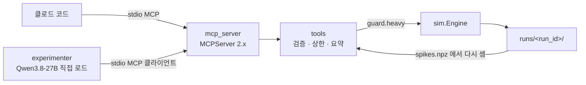

# fly-connectome-closed-loop — tool 구현 플랜 (P) · B 단계 도구 서버

## 헤더

- **요구사항**: 3340 — [./20260921-233859-3340_fly-connectome-closed-loop_req.md](./20260921-233859-3340_fly-connectome-closed-loop_req.md)
- **인터페이스 계약(I)**: [./20260921-233859-3340_fly-connectome-closed-loop_interface-design.md](./20260921-233859-3340_fly-connectome-closed-loop_interface-design.md) §2 (승인 v2)
- **모듈**: tool — 저장소 `GitHub/moai-echomind-fly-connectome` 의 `tools.py` · `mcp_server.py` · `experimenter.py` · `loop/qwen.py`
- **작성일**: 2026-09-22
- **Goal**: 언어 모델(클로드 코드 · Qwen)이 MCP(stdio)로 초파리 실험을 설계 → 실행 → 요약까지 한다. 상한은 코드가 막고, 돌려주는 것은 요약뿐이다.
- **Architecture**:

- **Tech Stack**: mcp 2.2.0(`MCPServer` · `stdio_client` · `ClientSession`) · mlx 0.32 · mlx-lm 0.31(Qwen 직접 로드) · anyio
- **선행 P 의존성**: [core](./20260921-233859-3340_fly-connectome-closed-loop-core_dev-plan.md)(엔진 · 실행 기록 · 가드)

> 요구자 위임으로 구현과 같은 흐름에서 쓰였다. 코드 정본은 저장소 커밋 `ec1ba83`(F-008) · `49c4c99`(F-009).

---

## Task 1: 도구 본체 (F-008)

**Files**: `src/moai_echomind_fly/tools.py` · `config/tool.yaml` · `tests/test_tools.py`

- [x] `find_neurons` · `run_experiment` · `get_run` · `compare_runs` · `list_runs` — 순수 함수(MCP 와 Qwen 이 같은 것을 부른다)
- [x] 상한(tool.yaml): 길이 1,000 ms · 자극 3,000 · 침묵 5,000 · 발화율 300 Hz · 허용 superclass → 코드가 거부(`over_limit` · `not_allowed` · `unknown_type` · `busy` · `low_memory`)
- [x] 요약(I §1.5)은 `spikes.npz` 에서 다시 센다
- Run: `uv run pytest tests/test_tools.py` → Expected: 상한 초과 6종 거부 · 거부하면 기록을 안 남김 · 요약 = 원본 재계산

## Task 2: MCP 서버 (F-008)

**Files**: `src/moai_echomind_fly/mcp_server.py` · `.mcp.json` · `tests/test_mcp_e2e.py`

- [x] MCP SDK 2.x `MCPServer` · 도구 다섯 · 서버 지침(instructions)에 모델의 한계를 적음
- [x] 실행 로그는 표준 에러로(stdio 서버의 표준 출력은 프로토콜 통로)
- Run: `uv run pytest tests/test_mcp_e2e.py` → Expected: 실제 stdio 클라이언트로 목록 · 찾기 · 거부 · 실행 · 기록 확인

## Task 3: Qwen 실험자 (F-009)

**Files**: `src/moai_echomind_fly/loop/qwen.py` · `src/moai_echomind_fly/experimenter.py` · `config/llm.yaml` · `src/moai_echomind_fly/guard.py` · `tests/test_qwen_parse.py` · `tests/test_guard.py`

- [x] 가중치 직접 로드(oMLX 폴더 · 서버 없음) · 생각 모드 끔 · 탐욕 복호
- [x] Qwen3.8 채팅 틀의 도구 호출 형식 `<tool_call><function=…><parameter=…>` 읽기
- [x] 실험자가 띄운 MCP 서버(자식)는 부모의 무거운 실행 잠금 안에서 돈다(`FLY_GUARD_OWNER`)
- Run: `uv run fly-connectome experiment "거대섬유(DNp01)를 켜면 다리 운동 뉴런까지 반응하나? …"`
- Expected: 도구로 실험을 부르고 답한다 · 인용한 run_id 가 전부 실재(`cited_missing == []`)

## 최종 검증

- Run: `uv run pytest` · `uv run ruff check src tests` → Expected: 전부 통과
