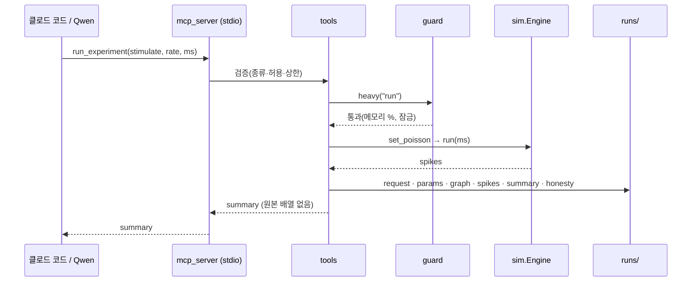
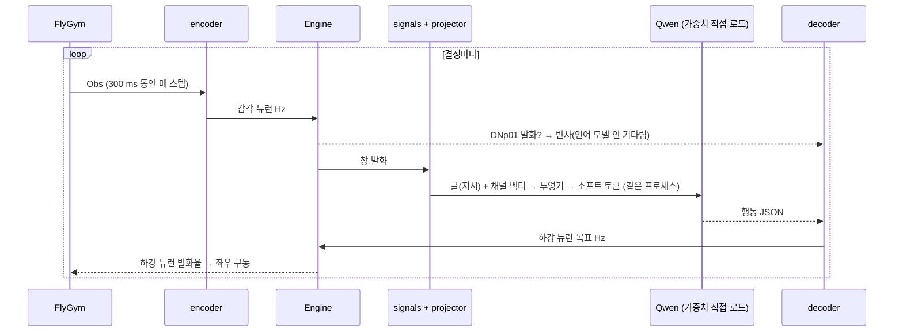

# fly-connectome-closed-loop — 인터페이스 계약 (I)

## 메타데이터

- **요구사항**: 3340 — [./20260921-233859-3340_fly-connectome-closed-loop_req.md](./20260921-233859-3340_fly-connectome-closed-loop_req.md)
- **작성일**: 2026-09-21 23:50:16
- **상태**: 승인
  <!-- 허용값(enum): 초안 | 검토 | 승인 — 상태=승인 전 P 작성 금지 (/DEV_PROCESS.md G2) -->
- **승인 근거**: 요구자 2026-09-21 *"변경이 필요하면 변경해서 구현해봐"* — G1 승인과 함께 구현 착수를 위임받았다(G2 위임). 구현하며 바뀌는 결정은 아래 개정 이력에 남긴다.
- **개정 이력**:

| 판 | 날짜 | 무엇 | 번복 대상 |
|---|---|---|---|
| v1 | 2026-09-21 | 최초 | — |
| v3 | 2026-09-22 | 구현하며 바뀐 것: ① 몸 = **FlyGym 1.x 별도 3.12 프로세스**(`body/fly_body_server.py` · 표준 입출력 JSON 한 줄 · `reset`/`step(drive, ms)`/`close`) — 2.1 에 보행 제어기·냄새 없음(R 1.3-8) ② **직접 자극한 뉴런(감각 입구 · 명령 하강 뉴런)은 채널 벡터에서 뺀다** — 벡터가 입력을 되읽지 않게 ③ 투영기 기본 = mlp2(너비 256) — 선형이면 채널 하나에 1억 매개변수 ④ 자리 표시 = `<|vision_pad|>`(248055) ⑤ 학습 = `grad_checkpoint`(mlx-lm 공개 함수) · 걸음당 5~8 s · 최대 약 90 GB | v2 §3.4 · §3.2 투영기 기본값 |
| v2 | 2026-09-21 | **C 를 "초파리 신호 벡터 → Qwen 입력 임베딩 직접 주입" 구조로**(요구자 · R-3340 1.3-7). Qwen 은 서버(Ollama)가 아니라 우리 프로세스에서 가중치 직접 로드(mlx-lm · oMLX 폴더 Uncensored 8bit). 채널 벡터 · 투영기 · 글과 신호를 섞은 입력 · 캡션/행동 학습 · 비교군 다섯 | v1 §0 `loop/` 행 · §2.3 Ollama 검사 · §3.2 · §3.5 · §4 둘째 시퀀스 · §6 |

> 이 계약은 **한 저장소 안의 단계(A·B·C) 사이 경계**다. 네트워크 API 는 없다(MCP 는 stdio). 저장소는 파일이다(DB 없음).

---

## 0. 저장소와 패키지

- 저장소: `GitHub/moai-echomind-fly-connectome` (moai-echomind 와 형제)
- 패키지: `src/moai_echomind_fly` (월드 서버의 `moai_echomind_world` 처럼 짧게) · 빌드 hatchling · Python 3.14 · ruff 100자
- 명령: `fly-connectome <하위 명령>`

| 하위 모듈 | 단계 | 기능 |
|---|---|---|
| `paths.py` · `config.py` | 공통 | 저장소 경로 · 설정 파일 읽기(판 번호 포함) |
| `guard.py` | 공통 | 메모리 여유 · 무거운 실행 잠금 |
| `data.py` | A | F-001 공식 파일 받기 · SHA 대조 |
| `graph.py` | A | F-002 그래프 컴파일 · 섞은 배선 |
| `sim.py` | A | F-003 LIF 엔진 |
| `protocols.py` | A | 자극 규약(다가옴 · 청각 · 단맛 · 광수용체) |
| `bench/escape.py` · `bench/limits.py` | A | F-004 · F-005 |
| `runs.py` | A | F-007 실행 기록 |
| `tools.py` · `mcp_server.py` | B | F-008 도구 본체(순수 함수) + MCP 포장 |
| `experimenter.py` | B | F-009 Qwen 실험자 |
| `loop/world.py` · `loop/encoder.py` | C | F-010 · F-011 세계 → 초파리 감각 뉴런 |
| `loop/signals.py` | C | F-012 채널 표 → 채널별 벡터(발화 + 문턱 아래 막전위) · 비교군용 글 요약 |
| `loop/qwen.py` | C | F-013 가중치 직접 로드(mlx-lm) · 글 + 신호 토큰을 섞은 입력 임베딩 · 생성 |
| `loop/projector.py` · `loop/teacher.py` · `loop/train.py` | C | F-017 채널별 투영기 · 교사 정책·캡션 · 정렬/행동 학습 |
| `loop/decoder.py` · `loop/orchestrator.py` · `loop/scorecard.py` | C | F-014 · F-015 · F-016 |

---

## 1. 모듈 간 계약

### 1.1 명령 (CLI)

| 명령 | 하는 일 | 무거움 |
|---|---|---|
| `fly-connectome download` | 공식 파일 3개 받기 · SHA 대조 | 네트워크 1.1 GB |
| `fly-connectome graph [--neurons traced] [--rewired-seed N]` | 그래프 컴파일 → `data/graph/` | CPU 수 분 |
| `fly-connectome run --stim TYPE[,TYPE] --rate HZ --ms MS [--silence TYPE] [--seed N] [--device mps\|cpu]` | 실험 한 번 → `runs/` | **무거움**(가드) |
| `fly-connectome bench escape [--trials 40] [--rewired]` | F-004 채점 | **무거움** |
| `fly-connectome bench limits` | F-005 한계 측정 | **무거움** |
| `fly-connectome mcp` | MCP 서버(stdio) | 요청마다 가드 |
| `fly-connectome experiment "질문"` | F-009 Qwen 실험자 | **무거움**(Qwen) |
| `fly-connectome collect --policy teacher\|projector --seeds 0-49` | F-017 학습 데이터(신호 벡터 · 캡션 · 교사 행동) 모으기 | **무거움** |
| `fly-connectome train --stage caption\|action [--graph rewired]` | F-017 투영기 학습(Qwen 얼림) | **무거움**(Qwen 역전파) |
| `fly-connectome ask "질문" --run <run_id>` | 글 질문 + 그 실행의 신호 → 글 대답 | **무거움**(Qwen) |
| `fly-connectome loop --config vector\|text\|no_circuit\|rewired\|no_llm --seed N` | C 에피소드 하나 | **무거움** |
| `fly-connectome scorecard --seeds 0-9` | F-016 성적표 | **무거움** |

"무거움" 은 전부 `guard.heavy()` 를 지난다(2.3).

### 1.2 그래프 (A 안쪽 계약 — `graph.py` → `sim.py`)

`data/graph/<name>.npz` + `<name>.json`(메타데이터). `<name>` = `traced-v1` · 섞은 배선은 `traced-v1.rewired-s<seed>`.

| 배열 | 형 | 뜻 |
|---|---|---|
| `body_ids` | int64[N] | 오름차순 bodyId — 인덱스 ↔ bodyId |
| `type` · `class_` · `superclass` · `instance` | str[N] | 주석 칸 그대로(빈 값은 `""`) |
| `nt` | str[N] | `consensus_nt` 소문자 · 행이 없으면 `"missing"` |
| `sign` | int8[N] | +1 아세틸콜린 · −1 GABA·글루탐산·히스타민 · 0 도파민·세로토닌·옥토파민·unclear·missing |
| `row_ptr` | int64[N+1] | 출발 뉴런별 연결 구간(CSR) |
| `dst` | int32[E] | 도착 인덱스(출발 순으로 정렬) |
| `count` | int32[E] | 시냅스 수(≥ 1) |

연결 세기는 불러올 때 계산한다: `w = sign[src] × count × w_syn × w_scale` (Shiu 방식 · 정규화 없음).
메타데이터(JSON): 원본 SHA 3개 · 뉴런 집합 규칙 · N · E · 시냅스 총수 · 부호별·물질별 뉴런 수 · 케니언 세포 부호 · 섞은 배선이면 씨앗과 원본 이름.

**섞은 배선** = 도착 배열을 무작위 순열로 섞는다 → 뉴런마다 나가는 연결 수(출발은 그대로)와 들어오는 연결 수(도착 값의 개수)가 원본과 같다. 연결마다 시냅스 수·출발 부호는 그대로 따라간다.

### 1.3 LIF 엔진 (`sim.py`)

```python
@dataclass(frozen=True)
class LIFParams:          # config/sim.yaml 에서 읽는다 · version 칸 필수
    v0_mV: float = -52.0; v_reset_mV: float = -52.0; v_th_mV: float = -45.0
    t_mbr_ms: float = 20.0; tau_syn_ms: float = 5.0; t_rfc_ms: float = 2.2; t_dly_ms: float = 1.8
    w_syn_mV: float = 0.275; w_scale: float = 1.0          # w_scale 은 F-004 규칙으로만 정한다
    poisson_kick_mV: float = 0.275 * 250                   # Shiu: w_syn × f_poi(250)
    dt_ms: float = 0.1
    tau_adapt_ms: float = 100.0                            # 적응: 기본 꺼짐(b_adapt 0)

class Engine:
    def __init__(self, graph, params, *, device="cpu"|"mps", dtype=float32|float64, seed=0): ...
    def reset(self) -> None
    def set_poisson(self, idx: np.ndarray, rate_hz: np.ndarray) -> None   # 자극 뉴런 불응기 0 (Shiu)
    def set_adaptation(self, idx, b_adapt_mV) -> None                       # 출처 있는 것만(정직 목록)
    def silence(self, idx) -> None                                           # 나가는 연결 세기 0
    def record_voltage(self, idx) -> None
    def run(self, ms: float) -> None                                         # 이어 달리기 가능(t 유지)
    spikes() -> tuple[np.ndarray, np.ndarray]    # (step, neuron) 전체 발화
    voltage() -> np.ndarray                       # [steps, len(idx)] 기록한 전압(mV)
```

**한 스텝 순서** — Brian2 기본 일정(`groups → thresholds → synapses → resets`)과 같게 해서 Brian2 대조가 1 스텝 안에서 맞게 한다:

1. **상태 갱신**(불응 중이 아닌 뉴런만 · Shiu 의 `unless refractory`) — 선형 식의 **정확한 해**:
   `u=v−v0` · `a=e^{−dt/t_mbr}` · `b=e^{−dt/τ}` →
   `u' = u·a + g·τ/(τ−t_mbr)·(b−a) − A·τ_A/(τ_A−t_mbr)·(e^{−dt/τ_A}−a)` · `g' = g·b` · 적응 `A' = A·e^{−dt/τ_A}`(적응은 불응과 무관하게 줄어든다)
2. **문턱**: `v > v_th` 이고 불응 중이 아님 → 발화
3. **전달**: `t_dly/dt` 스텝 전에 발화한 뉴런의 나가는 연결만 `g[dst] += w` (발화한 뉴런의 CSR 구간만 펼친다) · 포아송 사건이 난 자극 뉴런은 `v += poisson_kick`
4. **리셋**: 발화한 뉴런 `v = v_reset` · `g = 0` · `A += b_adapt` · 불응 시작

포아송 자극은 **씨앗으로 CPU 에서 미리 만든다**(스텝 × 자극 뉴런 불리언) → 장치와 무관하게 같은 입력.

### 1.4 실행 기록 (`runs.py`)

`runs/<run_id>/` · `run_id = YYYYMMDD-HHMMSS-<종류>-<4자리 16진>`

| 파일 | 내용 |
|---|---|
| `request.json` | 부른 쪽의 요청 원문(CLI 인자 / MCP 인자 / 조율기 설정) |
| `params.json` | `LIFParams` 전체 + 설정 파일 판(`sim.yaml` · `loom.yaml` …) + 장치 · dtype · 씨앗 |
| `graph.json` | 쓴 그래프 이름 + 메타데이터 복사(원본 SHA 포함) |
| `spikes.npz` | `step` int32[S] · `neuron` int32[S] · `dt_ms` · (있으면) `v_idx` · `voltage` |
| `summary.json` | 1.5 의 요약 |
| `honesty.md` | 배선이 낸 것 / 코드가 더한 것(자극 규약 · 덧붙인 고유 성질 · 대응표) |
| `stdout.log` | 가드 결과(메모리 여유 %) · 벽시계 시간 |

### 1.5 요약 (B 가 돌려주는 것 · `tools.summarize(run_id)`)

```json
{
  "run_id": "20260922-010203-run-3fa2",
  "duration_ms": 200, "dt_ms": 0.1, "graph": "traced-v1", "params_version": "sim-v1",
  "stimulated": {"types": ["DNp01"], "neurons": 2, "rate_hz": 150},
  "silenced": {"types": [], "neurons": 0},
  "spiking_neurons": 1234, "total_spikes": 5678,
  "population_rate_hz": 0.0172,
  "top_types": [{"type": "…", "superclass": "…", "neurons_fired": 12, "neurons_total": 40, "spikes": 90}],
  "descending": [{"type": "DNp01", "spikes": 30, "first_spike_ms": 1.9}],
  "motor": [{"type": "TTMn", "spikes": 0, "first_spike_ms": null}],
  "baseline": "silent network: 0 spikes without stimulus (F-003 test)",
  "raw": "runs/<run_id>/spikes.npz",
  "honesty": ["stimulus = Poisson kicks (Shiu 2024)", "w_scale fitted by F-004 rule (sim-v1)"]
}
```

`top_types` 는 20개까지 · `descending` 은 발화한 하강 뉴런 종류 전부(최대 50) · `motor` 는 발화한 운동 뉴런 종류 전부(최대 50).
요약의 모든 숫자는 `spikes.npz` 에서 다시 셀 수 있어야 한다(F-008 시험).

---

## 2. MCP 도구 계약 (B · `mcp_server.py` — stdio)

### 2.1 도구

| 이름 | 입력 | 출력 |
|---|---|---|
| `find_neurons` | `query: str` · `field: "type"\|"class"\|"superclass" = "type"` · `limit: int = 20` | `[{type, neurons, superclass, class, sign}]` (종류로 묶음) |
| `run_experiment` | `stimulate: list[str]`(종류) · `rate_hz: float = 150` · `duration_ms: int = 200` · `silence: list[str] = []` · `seed: int = 0` · `purpose: str` | 1.5 요약 |
| `get_run` | `run_id: str` | 1.5 요약 |
| `compare_runs` | `run_a: str` · `run_b: str` | `{run_a, run_b, types: [{type, spikes_a, spikes_b, diff}]}` 차이 큰 순 20 |
| `list_runs` | `limit: int = 20` | `[{run_id, created, stimulate, duration_ms, total_spikes}]` |

### 2.2 에러 계약 (MCP `isError: true` + 첫 줄 코드)

| 코드 | 조건 |
|---|---|
| `unknown_type` | 없는 종류 이름(비슷한 이름 5개를 같이 준다) |
| `not_allowed` | 자극 허용 목록(`config/tool.yaml` 의 superclass · 종류) 밖 |
| `over_limit` | `duration_ms` · 자극 뉴런 수 · 침묵 뉴런 수 · `rate_hz` 상한 초과(상한 값을 같이 준다) |
| `busy` | 다른 무거운 실행이 잠금을 쥐고 있음 |
| `low_memory` | `memory_pressure` 여유가 문턱 미만(지금 값과 문턱을 같이 준다) |
| `unknown_run` | 없는 run_id |

### 2.3 실행 가드 (`guard.py` — A·B·C 공통)

```python
def heavy(kind: str) -> ContextManager[GuardReport]:
    """무거운 실행 전 검사. 통과 못 하면 GuardRefused(code, message)."""
    # 1. memory_pressure 여유 % >= config/guard.yaml min_free_percent(40)
    # 2. 잠금 파일 runs/.heavy.lock (pid · kind · 시작 시각) — 다른 살아 있는 pid 가 쥐면 busy
    # 3. kind == "qwen" 이면 가중치 크기(28 GB)만큼 더 여유가 있는지 본다 — 서버는 쓰지 않는다
```

---

## 3. 닫힌 고리 계약 (C · `loop/`)

### 3.1 세계 → 인코더

```python
@dataclass
class Obs:
    t_ms: float
    looming: dict[str, list[VisualObject]]   # "L"/"R" → [{azimuth_deg, size_deg, expansion_deg_s}]
    odor: dict[str, float]                   # "L"/"R" 더듬이 농도(과제의 냄새 하나)
    leg_contact: dict[str, float]            # "LF"…"RH" 접촉 힘(N)
    position: tuple[float, float]; heading_rad: float
```

인코더 출력 = `dict[int, float]`(뉴런 인덱스 → Hz). 대응표 `config/sensory_map-v1.yaml` — 표마다 `from_annotation` · `filled` 수.
시각 입구 = LC/LPLC(R-3340 1.3-1) · 냄새 = ORN(사구체) · 다리 = 기계감각(다리 신경 `entryNerve`).

### 3.2 초파리 → LLM: 채널 벡터와 섞은 입력 (F-012 · F-013 · F-017)

**구도**: 초파리 회로 = 인코더(앞) · 투영기 = 다리 · Qwen = 생성기(뒤) — 이미지 생성(글 인코더 → 디퓨전)의 반대.

채널 벡터(`loop/signals.py`) — 창 300 ms 를 B 구간(기본 3 × 100 ms)으로 나눠, 채널의 단위(종류 × 좌우)마다 두 값:

```python
@dataclass
class ChannelVector:
    name: str             # "vision" | "touch" | "hearing" | "smell" | "taste" | "courtship" | "value" | "body" | "motor"
    units: list[str]      # ["LC4:L", "LC4:R", …] — 판 잠긴 채널 표(config/channels-v1.yaml)에서
    rate: np.ndarray      # [B, len(units)] 발화율 Hz
    depol: np.ndarray     # [B, len(units)] 평균 탈분극 mV (v − v0) — 문턱 아래 신호
    def features(self) -> np.ndarray   # log1p(rate)/s_r , depol/s_v 를 이어 붙임 → [2·B·len(units)]
```

투영기(`loop/projector.py` · MLX) — 채널마다 하나, 학습되는 것은 이것뿐:

```python
class ChannelProjector(nn.Module):     # 선형(기본) | mlp2(LLaVA 식) — config/projector-v1.yaml
    def __call__(self, x: mx.array) -> mx.array   # [d_channel] → [k, 5120] 소프트 토큰
```

섞은 입력(`loop/qwen.py`) — 글 토큰 사이에 소프트 토큰 자리를 둔다:

```
<|im_start|>system 너는 초파리 몸을 조종한다 … 목표 …<|im_end|>
<|im_start|>user [지시 또는 질문 글]
<vision>⟨k⟩</vision> <touch>⟨k⟩</touch> <hearing>⟨k⟩</hearing> <smell>⟨k⟩</smell> <taste>⟨k⟩</taste>
<courtship>⟨k⟩</courtship> <value>⟨k⟩</value> <body>⟨k⟩</body> <motor>⟨k⟩</motor> [글]<|im_end|>
<|im_start|>assistant
```

- 채널 이름 태그·지시·질문은 **글 토큰**(토크나이저 그대로), `⟨k⟩` 는 자리 표시 토큰 k 개 → 임베딩 단계에서 투영기 출력으로 **바꿔 끼운다**.
- 지시가 행동이면 출력은 3.3 의 행동 JSON, 질문이면 글 대답(캡션).
- `qwen.embed_and_splice(prompt, soft: dict[str, mx.array]) -> mx.array` · `qwen.generate(embeddings, max_tokens) -> str` ·
  `qwen.loss(embeddings, target_text) -> mx.array`(정답 토큰의 교차 엔트로피 · 투영기로만 기울기).

**비교군 `text`** — 같은 창의 글 요약(06 §3.2 서식, 300 토큰 이하)을 소프트 토큰 대신 넣는다:

```
[감각 요약 · 창 300ms · run <run_id> · 채널 표 v1]
vision : LC4 L=0.10 R=0.82 · LPLC2 L=0.05 R=0.64
smell  : food 0.61 (R > L, 차 0.18)
touch  : contact LF RM RH
motor  : DNp01 14Hz · DNa02_R 6Hz
last   : {"walk":0.4,"turn":"right","stop":false} (1.2s 전)
```

**학습 데이터**(`runs/dataset-<판>/`) — 결정 창마다 한 줄: 채널 특징(npz) · 세계 참값 · **캡션**(참값에서 코드가 만든 글) · **교사 행동 JSON** · 씨앗 · 그래프 이름.
캡션 예: `다가오는 물체: 오른쪽 · 가까움 / 먹이 냄새: 왼쪽 · 약함 / 다리 접촉: 여섯 다리 / 소리: 없음 / 암컷 대용 물체: 없음`

### 3.3 판단 → 디코더 (행동 JSON 스키마)

```json
{"type": "object", "additionalProperties": false,
 "required": ["walk", "turn", "stop"],
 "properties": {
   "walk": {"type": "number", "minimum": 0, "maximum": 1},
   "turn": {"enum": ["left", "right", "none"]},
   "turn_strength": {"type": "number", "minimum": 0, "maximum": 1},
   "stop": {"type": "boolean"},
   "groom": {"type": "boolean"},
   "note": {"type": "string", "maxLength": 160}}}
```

- 스키마 밖 · 카탈로그 밖 키 → 거부하고 직전 명령 유지(기록).
- `escape` 는 **언어 모델이 내지 않는다** — 회로의 DNp01 반사 빠른 길만 낸다.
- 카탈로그 `config/dn_catalog-v1.yaml`: 키 → 하강 뉴런 종류 목록 · 최대 발화율 · 출처.

### 3.4 디코더 → 몸

하강 뉴런 목표 발화율 → 포아송 자극(100~200 ms 선형 전환) → **회로가 낸 하강 뉴런 발화율**을 읽어 FlyGym 보행 제어기의 좌우 구동 두 값으로 바꾼다(06 의 (나) 갈래 · 대응 규칙은 `dn_catalog` 에 · 정직 목록에 "코드가 더한 것").

### 3.5 비교군·대조군

| 구성 | 앞(인코더) | 뒤 | 가르는 것 |
|---|---|---|---|
| `vector` **본 설계** | 인코더 → 회로 → 채널 벡터 → 투영기 | Qwen | — |
| `text` | 인코더 → 회로 → 글 요약 | Qwen | 벡터가 글보다 나은가 |
| `no_circuit` | 세계의 원시 값(숫자 + 영상 한 장) | Qwen | 회로를 거치는 것이 도움이 되나 |
| `rewired` | 인코더 → **섞은 배선** 회로 → 채널 벡터 → 투영기(**똑같이 학습**) | Qwen | 초파리 배선 덕인가 |
| `no_llm` | 인코더 → 회로 → 하강 뉴런 그대로 | 없음(반사만) | LLM 이 더한 것이 있나 |

성적표 `runs/scorecard-<날짜>/scorecard.json` + `.md`: 구성 × 씨앗(학습에 안 쓴 것) → 캡션 정확도 · 도달 · 도달 시간 · 회피 · 결정당 지연 · 평균 · 표준편차.

---|---|---|
| `design` | 세계 → 인코더 → 회로 → 읽기 → 텍스트 | Qwen |
| `no_circuit` | 세계의 원시 값(숫자 + 영상 한 장) | Qwen |
| `rewired` | 인코더 → **섞은 배선** 회로 → 읽기 | Qwen |
| `no_llm` | 인코더 → 회로 → 하강 뉴런 그대로 | 없음(반사만) |

성적표 `runs/scorecard-<날짜>/scorecard.json` + `.md`: 구성 × 씨앗 → 도달 · 도달 시간 · 회피 · 결정당 토큰 · 평균 · 표준편차.

---

## 4. 모듈 간 시퀀스





---

## 5. 저장소 (DB 대신 파일)

| 자리 | 무엇 | git |
|---|---|---|
| `config/*.yaml` | 매개변수 · 대응표 · 상한 · 카탈로그(판 번호) | ✅ 커밋 |
| `data/raw/` | 공식 파일 3개(1.1 GB) | ❌ gitignore |
| `data/graph/` | 컴파일된 그래프 | ❌ |
| `runs/` | 실행 기록 · 성적표 | ❌ (W 에는 필요한 줄만 옮긴다) |

---

## 6. 접근제어

- 네트워크에 여는 것이 없다(MCP stdio · Qwen 은 로컬 가중치 파일을 우리 프로세스가 직접 읽는다).
- 비밀 값 없음.

---

## 7. Out of Scope

R-3340 5장과 같다.
