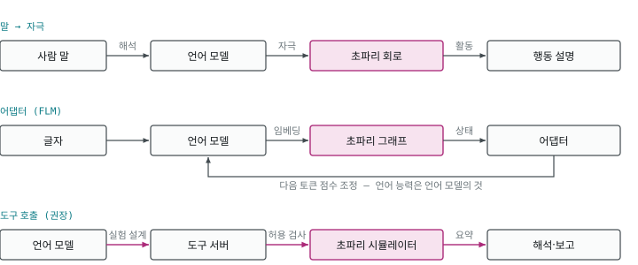
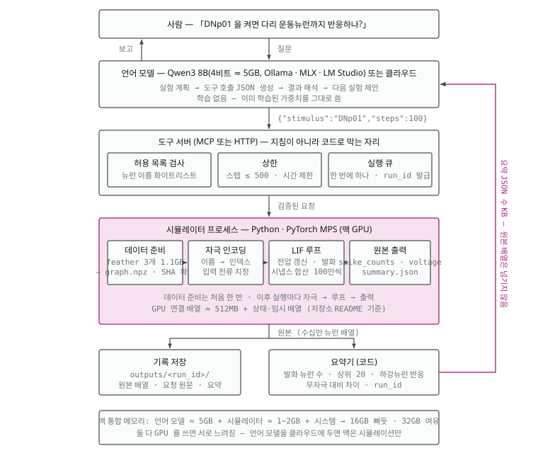

# 05. 언어 모델과 잇기 — 방식과 방향

> 맥에서 무엇을, 어느 자리에 붙이면 쓸모 있나. 공개된 사례 셋의 README 원문과 공식 문서 기준.

## 먼저 — 무엇이 먼저 도나

「초파리 뇌와 LLM 을 이었다」는 말은 구성마다 방향이 다르다.



| 구성 | 흐름 | 초파리의 자리 |
|---|---|---|
| 말 → 자극 (fly-brain · CHIMERA) | 사람 말 → (작은 언어 모델이 해석) → 감각 뉴런 자극 → 회로 → 행동을 말로 설명 | 가운데. 자극 대응은 **사람이 정해 둔 표** |
| 어댑터 (FLM) | 글자 토큰 임베딩 → 회로(16.67만 노드) → 어댑터(27.8만 매개변수)가 상태를 읽음 → 언어 모델의 다음 토큰 점수 조정 | 가운데. **글자가 먼저**이고, 언어 능력은 얼린 언어 모델에서 옴(저장소 명시) |
| 감각 닫힌 고리 (DOOMFLY 류) | 화면·센서 → 광수용체 → 회로 → 특정 뉴런 활동 → 조작 신호 | **먼저**. 언어 모델은 끼지 않거나 해설만 |
| **도구 호출 (권장)** | 사람·언어 모델이 실험 설계 → 시뮬레이터 실행 → **요약된 결과** → 언어 모델이 해석·보고 | 판정자. 먼저 돌고, 결과만 언어 모델에 넘김 |

가운데 두 구성에서는 **초파리가 정말 기여했는지**를 따로 보여야 한다. 그래프를 무작위로 섞거나 끊었을 때 출력이 달라지는지 비교하는 대조군이 없으면, 결과는 언어 모델이 낸 것과 구분되지 않는다.

## 어느 부분을 잇는 게 좋은가

한 문장: **언어 모델은 실험자 자리에, 커넥톰은 피험체 자리에.**

| 붙일 만한 자리 | 피할 자리 |
|---|---|
| 실험 설계와 반복 — 「어떤 뉴런 조합을 켜면 이 하강뉴런이 반응하나」를 언어 모델이 제안하고 시뮬레이터가 판정 | 스파이크 배열을 통째로 언어 모델에 넣고 「행동」을 말하게 하기 — 지어낸다 |
| 데이터 질의 통역 — 「DNp01 에서 다리 운동뉴런까지 경로」를 neuPrint 질의로 | 회로 안에 언어 모델을 끼워 넣어 어느 쪽이 결과를 냈는지 흐리게 하기 |
| 결과 요약과 보고 · 분석·그림 코드 생성 | 계산된 값(발화 수·경로)을 언어 모델이 고쳐 쓰게 두기 — 계산값은 시뮬레이터가 정본 |

## 권장 파이프라인 — 상세



- **학습되는 것은 없다.** 언어 모델은 이미 학습된 가중치를 그대로 쓰고, 커넥톰은 고정 배선.
- **도구 서버가 지침이 아니라 코드로 막는다** — 허용 목록(자극 가능한 뉴런 이름), 상한(스텝 ≤ 500 · 시간), 실행 큐(한 번에 하나 · run_id).
- **언어 모델에 주는 것은 요약뿐** — 발화 뉴런 수 · 상위 20 · 하강뉴런 반응 · 무자극 대비 차이 · run_id. 원본 배열(수십만 뉴런)은 파일로 남긴다.
- 맥 통합 메모리: 언어 모델 ≈ 5GB(8B 4비트 기준) + 시뮬레이터 ≈ 1~2GB + 시스템 → 16GB 빠듯, 32GB 여유. 둘 다 GPU 를 쓰면 서로 느려지므로 언어 모델을 클라우드에 두면 맥은 시뮬레이션만 한다.

도구 서버 뼈대(설명용):

```python
# 원칙: 계산은 시뮬레이터가, 말은 언어 모델이. 스파이크 배열은 안 넘기고 '요약'만.
ALLOWED = {"DNp01", "DNa01", "DNge104"}     # 자극 가능한 이름만
MAX_STEPS = 500

def simulate(stimulus: str, steps: int = 100) -> dict:
    if stimulus not in ALLOWED:               # 지침이 아니라 코드로 막는다
        return {"error": "허용되지 않은 자극", "allowed": sorted(ALLOWED)}
    out = run_malecns(stimulus, min(steps, MAX_STEPS))   # mps 시뮬레이터
    return {
        "stimulus": stimulus, "steps": out.steps,
        "spiking_neurons": int((out.spike_counts > 0).sum()),
        "top": out.top_neurons(20),            # 이름·발화 수 20개
        "descending_hit": out.hit_descending(),
        "run_id": out.run_id,                  # 원본은 파일로, 참조만
    }
```

잇는 방법 셋: **도구 서버(MCP)**로 감싸 클로드 데스크탑·클로드 코드에서 부르기(공개된 커넥톰 도구 서버는 찾지 못했으니 직접 만들 자리) · **로컬 HTTP**(FastAPI)+함수 호출 · **파일**(요청·결과 JSON).

## 「학습된 가중치를 가져다 잇는」 방식인가 — Qwen 으로 생각해 보면

반은 맞다. **언어 모델 쪽은** 이미 학습된 가중치를 그대로 쓴다. **커넥톰 쪽은 학습된 가중치가 아니다** — 시냅스 수를 연결 세기로 쓰는 고정 배선이고, 발화 방정식은 붙이는 가정이다. 그래서 「두 모델을 합친다」보다 **「학습된 언어 모델 옆에 배선도 시뮬레이터를 붙인다」**가 정확하다. 자세한 것은 [07](07-지능은-누구-것인가.md).

| 방법 | 무엇을 학습하나 | 맥에서 | 얻는 것 · 한계 |
|---|---|---|---|
| **도구 호출(권장)** | 없음. 언어 모델이 도구 호출 형식으로 시뮬레이터를 부름 | 8B 4비트 ≈ 5GB, 27B 4비트 ≈ 16~19GB + 시뮬레이터 | 실험 자동화·요약·보고. 어느 쪽이 무엇을 했는지 분명 |
| 어댑터 학습(FLM 방식) | 언어 모델은 얼리고, 회로 상태 → 다음 토큰 점수를 잇는 작은 어댑터만. FLM 은 1.2B 모델에 27.8만 매개변수 | 27B 는 1.2B 보다 훨씬 무거움. 학습 목표·데이터(어떤 회로 상태가 어떤 말과 짝인가)를 직접 정해야 | 「말하는 초파리」 데모. 언어 능력은 언어 모델의 것 — 그래프 셔플 대조 필수 |
| 자극 주입(학습 없음) | 없음. 토큰·문장을 감각 뉴런 자극으로 **사람이 정한 표**로 바꾸고, 회로 요약을 프롬프트에 | 가장 가벼움 | CHIMERA·fly-brain 방식. 대응표가 곧 결과를 정하므로 해석 주의 |

## 이미 있는 사례

| 저장소 | 어떻게 이었나 | 알아 둘 것 |
|---|---|---|
| [FLM](https://github.com/nftechie/flm) | 얼린 LFM2.5-1.2B + 어댑터가 MaleCNS 그래프 상태를 읽어 다음 토큰 점수 조정. 맥(MPS)에서 학습 가능 | 디스크 10GB 이상, 램 16GB 이상 권장. 「언어 능력은 사전학습 모델의 것」 명시 |
| [fly-brain (lixiang1076)](https://github.com/lixiang1076/fly-brain) | 자연어를 자극으로 바꿔 FlyWire 회로를 돌리고, 행동을 말로 설명 | 단맛·쓴맛·도망 등 자극 대응표는 사람이 만든 것 |
| [CHIMERA](https://github.com/caparison1234/chimera) | Qwen 0.5B 가 말을 감각 채널로 해석 → 애벌레 커넥톰 1,373뉴런 → MuJoCo 몸. 한국어 입력도 받음 | 성체가 아니라 **애벌레** 회로. 회로가 작아 맥에서 가볍게 돔 |

「초파리가 먼저 감각을 받고 → 언어 모델이 판단하고 → 초파리가 행동으로 옮기는」 반대 방향의 설계는 [06](06-설계-초파리-회로에-Qwen-뇌.md).
