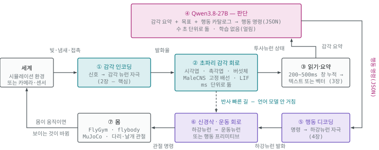
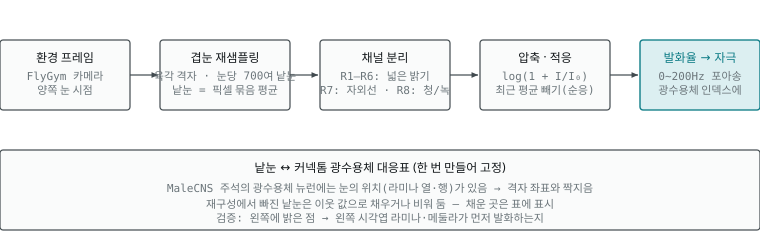
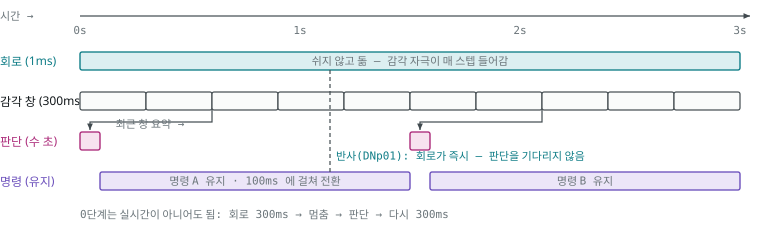

# 06. 설계 — 초파리 회로에 Qwen 뇌 잇기

> 초파리 감각 회로가 **먼저** 바깥 신호를 받아 처리하고, 그 결과를 Qwen3.8-27B 가 받아 판단하고, 판단을 다시 초파리의 하강뉴런·운동 회로가 받아 **행동으로 옮기는** 닫힌 고리의 설계.
> 부품 사양·수치는 공식 문서·저장소 원문에서 가져왔고, **설계(대응표·게인·창·카탈로그·단계)는 이 문서에서 처음 제안한 것**이다. 직접 돌려 보지 않았다.
> 이 설계에서 나오는 지능이 누구 것인지는 [07](07-지능은-누구-것인가.md) — **판단은 언어 모델의 것**이다. 만들기 전에 그 문서를 먼저 읽는다.

| 부품 | 값 |
|---|---|
| 초파리 쪽 | MaleCNS v1.0 — 뉴런 166,700 · 연결 2,558만 · CC BY 4.0 |
| 언어 모델 | Qwen3.8-27B — 64층 · 은닉 5,120 · 어휘 248,320 · Apache 2.0 · 2026-08 공개 · 이미지 입력 가능 |
| 실행 환경 | 맥 통합 메모리 32GB 이상 (24GB 최소 · 64GB 여유) |

---

## 0. 무엇을 만드는가

**초파리의 감각 주변부와 운동 주변부는 그대로 두고, 가운데 「판단」 자리에 언어 모델을 앉힌다.** 실제 초파리에서 감각 → 중심뇌 → 하강뉴런 → 신경삭 → 근육으로 가는 흐름 가운데, 중심뇌의 판단 부분을 Qwen 이 맡는다. [05](05-LLM-연동-방식.md)의 사례들(FLM·CHIMERA)과 반대 방향이다 — 거기서는 글자가 먼저였고, 여기서는 **세계가 먼저**다.



시계 방향 한 바퀴: **세계 → ① 감각 인코딩 → ② 초파리 감각 회로 → ③ 읽기·요약 → ④ 언어 모델 → ⑤ 행동 디코딩 → ⑥ 신경삭·운동 회로 → ⑦ 몸 → 세계.** 감각 인코딩(①)은 들어오는 쪽에서 한 번만 거치고, 언어 모델의 명령은 감각 인코딩을 다시 거치지 않고 행동 디코딩(⑤)으로 바로 간다. 초파리 회로(②·⑥)는 밀리초 단위로 계속 돌고, 언어 모델(④)은 수 초에 한 번 판단한다(맥 미니 M4 32GB 4비트 기준 결정당 7~10초 — [5장](#5-두-속도를-잇기)). 도망 같은 반사는 ②에서 ⑥으로 바로 이어지고(점선), 언어 모델은 느린 결정만 맡는다.

**이 설계에서 학습되는 것은 없어도 된다.** 0단계는 Qwen 을 얼린 채로 감각 요약을 *글*로 주고 행동 명령을 *글*로 받는다. 학습(읽기 어댑터·행동 헤드)은 그 뒤 선택 사항이다(7장). 커넥톰은 어느 단계에서도 고정 배선이다.

---

## 1. 부품과 자리

| 부품 | 무엇으로 | 도는 곳 | 속도 | 학습 |
|---|---|---|---|---|
| (감각) 세계 | FlyGym(NeuroMechFly v2) 환경 — 지형·냄새 원·시각 장면. 나중엔 카메라·마이크 | CPU (MuJoCo) | 물리 스텝 ~1ms | — |
| (감각) 감각 인코더 | 빛·냄새·접촉 → 감각 뉴런별 발화율. 2장 | CPU/GPU | 회로 스텝마다 | 없음(고정 규칙) |
| (감각) 초파리 회로 | MaleCNS 그래프 + LIF(mps-malecns-model 계열) — 뇌 전체를 돌리되 읽는 곳은 정함 | 맥 GPU(MPS) | dt 0.1~1ms | 없음(고정 배선) |
| (판단) 읽기·요약 | 투사뉴런·출력뉴런 집단의 창 누적 발화율 → 텍스트(0단계) 또는 벡터(1단계). 3장 | CPU | 200~500ms 창 | 0단계 없음 · 1단계 소형 어댑터 |
| (판단) Qwen3.8-27B | MLX 4비트. 시스템 프롬프트(몸·카탈로그·목표) + 감각 요약 → 행동 JSON | 맥 GPU(MLX) | 수 초/결정(5장) | 없음(얼림) |
| (행동) 행동 디코더 | 행동 JSON → 하강뉴런 자극 벡터. 4장 | CPU | 결정마다 | 없음 |
| (행동) 운동 회로·몸 | (가) 하강뉴런 → 신경삭 회로 → 운동뉴런 → 관절 / (나) 하강뉴런 → FlyGym 행동 프리미티브 | GPU / CPU | ms | (나) 프리미티브는 FlyGym 제공 |

맥 한 대에서 GPU 를 쓰는 것은 둘(초파리 회로 · Qwen)이다. 통합 메모리를 나눠 쓰므로 8장의 예산을 먼저 본다.

---

## 2. 핵심 — 신경 신호를 초파리에게 어떻게 줄 것인가

커넥톰은 「누가 누구와 이어졌나」만 말한다. **바깥 세계가 어떤 뉴런을 얼마나 세게 켜는지는 데이터에 없다.** 그래서 이 단계는 설계이고, 이 설계가 곧 실험 결과를 정한다. 다섯 가지를 정해야 한다.

1. **어느 뉴런에** — 감각별 입구 뉴런 집단(광수용체·후각 수용 뉴런·미각 수용 뉴런·기계감각 뉴런)
2. **무엇을 단위로** — 발화율(Hz) 또는 입력 전류. 발화율이 안전하다(Shiu 모델도 정해진 주파수의 포아송 발화로 자극)
3. **어떻게 대응시켜** — 물리량(밝기·농도·힘)을 발화율로 바꾸는 곡선
4. **얼마나 세게** — 게인. 너무 세면 뇌 전체가 발화하고, 약하면 아무 일도 없다
5. **어떤 시간 단위로** — 회로 스텝(ms)·세계 프레임(수십 ms)·언어 모델 결정(초)을 맞추는 법

> 손에 있는 시뮬레이터가 실제로 받는 입력·내는 출력은 [02 의 「mps-malecns-model 이 받는 입력과 내는 출력」](02-받아-쓰는-길.md#mps-malecns-model-이-받는-입력과-내는-출력--소스malecnspy에서-읽은-것) 에 코드 기준으로 적었다 — 명령줄은 「한 종류에 상수 자극」뿐이고, 세포별·스텝별 입력은 `ConnectomeLIF.forward(drive)` 를 파이썬으로 불러 넣는다. 히스타민 부호가 0 이라 광수용체 자극이 퍼지지 않는 점도 거기에 있다.

### 2.0 한눈에 — 종류 · 주입 · 강도

| 층 | 뉴런 종류 | 주입 — 무엇을 어떻게 | 강도 — 시작값과 맞추는 법 | 검산 |
|---|---|---|---|---|
| **입구 · 시각** | 광수용체 R1–R6(밝기), R7·R8(색). MaleCNS 추적 완료 4,107 개(히스타민 −) | 낱눈 밝기 → 로그 압축 → **발화율(Hz)** → 포아송 발화. 매 프레임 계속 | 0~200Hz. 어두움 0, 최대 밝기 200 | 왼쪽 밝은 점 → 왼쪽 시각엽 먼저 발화. 다가오는 그림자 → DNp01 |
| **입구 · 후각** | 후각 수용 뉴런, 사구체 약 50종 | 냄새 종류 → 사구체 반응표 × 농도 → 발화율 | 0~150Hz. 순응(같은 냄새 지속 시 감소) | 냄새를 오른쪽에 → 오른쪽 사구체 우세 → 투사뉴런 좌우 차 |
| **입구 · 미각** | 당·쓴맛·물·소금 수용 뉴런 | 접촉 물질 종류·농도 → 해당 종류만 발화 | 접촉 시 50~150Hz, 아니면 0 | 단맛 → 주둥이 뻗기 운동뉴런 |
| **입구 · 기계감각** | 다리·존스턴 기관 뉴런 | FlyGym 접촉 힘·관절 각도 → 발화율 | 힘에 비례, 상한 100Hz | 닿은 다리의 기계감각 뉴런만 반응 |
| **출구 · 행동** | 하강 뉴런(DNp01 · DNa02 · DNp09 계열 …) | 행동 JSON → 해당 집단 목표 발화율. 100~200ms 에 걸쳐 전환 | 명령값(0~1) × 집단 최대 발화율 | 자극 뒤 신경삭 운동뉴런이 그 방향으로 반응 |
| **조절(선택)** | 도파민(PAM·PPL1) · 옥토파민 뉴런 | 보상·처벌 판정 시 짧은 발화(100~300ms) + **시냅스를 바꾸는 규칙** | 규칙의 학습률이 곧 강도 — 데이터에 없어 사람이 정함 | 「무작위 보상」 대조군보다 나아지나 |

시작값(Hz)은 이 문서의 제안이고 실측이 아니다. 2.4 의 절차로 맞춘 뒤 파일로 잠근다.

**근사 하나** — 광수용체와 시각엽 앞단 뉴런은 실제로는 스파이크를 내지 않고 연속 전위로 신호를 보낸다. 발화율로 넣는 것은 근사이며, 거친 전파 예측에는 통하지만 시각 앞단의 세밀한 동작을 볼 때는 첫 번째 오차 원천이다.

### 2.1 감각별 입구 — 어느 뉴런에 무엇을

| 감각 | 입구 뉴런 (MaleCNS) | 세계 → 발화율 규칙 | 근거 자료 | 난이도 |
|---|---|---|---|---|
| 시각 | 광수용체 R1–R6(밝기·움직임), R7(자외선)·R8(청·녹). MaleCNS 추적 완료 기준 R1–R6 1,394 · R7 1,384 · R8 1,329 = **4,107**([08](08-데이터-실측.md)). 물질은 **히스타민(−)** — 빛이 들어오면 라미나가 억제되는 것이 맞는 동작 | 장면을 겹눈 격자로 재샘플링(FlyGym 눈당 **721 낱눈**, 창백형 216 · 노랑형 505) → 낱눈마다 밝기·색 → 로그 압축 → 발화율. **움직임은 시간차로 생기므로 프레임을 연속으로** 넣어야 방향 선택 뉴런이 반응. 대응은 주석의 `assignedOlHex1/2` 격자 좌표로 | FlyGym `compound_eye.npz` · flyvis | 가장 잘 됨 |
| 후각 | 더듬이·아랫입술수염 후각 수용 뉴런 → 촉각엽 사구체 약 50종 | 냄새 이름 → 사구체별 반응 표 → 농도로 배율 → 발화율. FlyGym 이 더듬이 위치의 농도를 계산해 줌 | DoOR 데이터베이스(냄새-수용체 반응 표) · 촉각엽 주석 | 됨 |
| 미각 | 주둥이·다리 미각 수용 뉴런 — 당·쓴맛·물·소금 | 접촉한 물질 종류·농도 → 해당 종류 뉴런 발화율. 접촉은 FlyGym 접촉 힘으로 판정 | Shiu 모델 단맛·쓴맛 실험 · MaleCNS 미각 동반 논문 | 됨 |
| 청각·기계감각 | 존스턴 기관 뉴런(진동) · 다리·몸 기계감각 뉴런(신경삭) | 소리 → 주파수 대역 → 존스턴 기관 그룹 발화율. 다리 접촉·관절 각도 → FlyGym 힘·각도 → 다리 기계감각 뉴런 | FlyGym 기계감각 피드백 · 신경삭 주석 | 됨(다리 쪽 대응이 큼) |
| 온도·습도 | 더듬이 온도·습도 수용기 | 환경 값 → 발화율 | 주석 | 쉬우나 쓸모 적음 |

**처음에는 시각·후각·다리 접촉 셋만 켠다.** 시각은 자료와 모델이 가장 좋고, 후각은 목표 지향 행동(냄새 찾아가기)을 만들며, 다리 접촉은 걷기 되먹임에 필요하다.

### 2.2 시각 입력의 상세 — 프레임 한 장이 광수용체 발화가 되기까지

> ⚠️ **구현에서 잰 것(R-3340 · 2026-09-22)**: 광수용체 R1–R6 1,394 개를 150 Hz 로 300 ms 자극해도 라미나·시각엽·그 뒤 **발화 0** 이었다. 빛 신호는 이중 반전(빛 → 광수용체 → 히스타민이 L1 억제 → L1 의 글루탐산 감소 → Mi1 이 풀림)으로 전달되는데, 쉬는 상태가 침묵인 LIF 는 「억제를 푸는」 경로를 표현하지 못한다(FLYCNS 도 같은 결론 — [09 의 4절](09-LIF-모델.md#4-이-모델이-맞은-것과-못-맞춘-것)). 그래서 구현은 아래 경로 대신 **계산한 시각 특징(방위 · 각 크기 · 확대 속도)을 시각 투사 뉴런(LC · LPLC)에 넣는다**(F1 모나코 · FLYCNS 와 같은 자리). 아래 설명은 설계 당시의 구상으로 남긴다.



1. **환경 프레임** — FlyGym 카메라, 양쪽 눈 시점
2. **겹눈 재샘플링** — 육각 격자, FlyGym 눈당 **721 낱눈**(원시 렌더 512×450, 시야 157°). 낱눈 = 픽셀 묶음 평균
3. **채널 분리** — R1–R6 넓은 밝기 · R7 자외선 · R8 청/녹
4. **압축·적응** — `log(1 + I/I₀)`, 최근 평균 빼기(순응)
5. **발화율 → 자극** — 0~200Hz 포아송, 광수용체 인덱스에

**낱눈 ↔ 커넥톰 광수용체 대응표**(한 번 만들어 고정): MaleCNS 주석의 광수용체 뉴런에는 눈의 위치(라미나 열·행)가 있어 격자 좌표와 짝지을 수 있다. 재구성에서 빠진 낱눈은 이웃 값으로 채우거나 비워 두고, 채운 곳은 표에 표시한다. 검증: 왼쪽에 밝은 점 → 왼쪽 시각엽 라미나·메둘라가 먼저 발화하는지.

왼쪽 네 단계는 어느 시뮬레이터에서도 같은 순수 계산이고, 마지막 대응표만 MaleCNS 주석에 기댄다. 움직임 감지는 프레임 사이 차이에서 회로가 스스로 만들어내므로, 인코더는 프레임을 *계속* 넣기만 하면 된다.

### 2.3 후각 입력의 상세

냄새는 시각보다 대응이 쉽다. 세계에 「냄새 원」 몇 개와 농도장이 있고, 초파리 더듬이 위치의 농도를 FlyGym 이 계산해 준다. 그 농도를 **냄새 종류별 수용체 반응 표**로 사구체(약 50종) 발화율로 바꾸고, 각 사구체의 후각 수용 뉴런 인덱스에 넣는다.

- 냄새 종류 → 수용체 반응은 DoOR 데이터베이스 같은 실험 표를 쓴다. 표에 없는 냄새는 **임의 벡터**라고 문서에 적는다.
- 농도 → 발화율은 시각과 같이 로그 압축 + 순응.
- 검증: 「먹이 냄새」를 오른쪽에 두면 오른쪽 더듬이 쪽 사구체가 더 발화하고, 투사뉴런을 거쳐 측각·버섯체에 활동이 나타나는지.

### 2.4 게인 보정 — 얼마나 세게

커넥톰 시뮬레이션의 가장 흔한 실패는 **뇌 전체가 발화하거나(폭주), 아무 데도 안 가는 것(침묵)**이다. 시냅스 세기를 시냅스 수로 근사하기 때문에 실제 세기 분포와 다르고, 그래서 입력 게인을 맞춰야 한다.

1. **목표 활동 수준** — 한 창(200ms) 안에서 발화하는 뉴런 비율이 전체의 1~5% 안.
2. **감각별로 게인을 따로** — 시각만 켜고 밝기 대비를 올려 가며 발화 비율을 재고, 후각도 같은 방법으로.
3. **알려진 반사로 검산** — 다가오는 그림자(looming) → 시각엽 LPLC2 계열 → 거대섬유 → DNp01 발화 = 시각 게인이 맞음. 단맛 → 주둥이 뻗기 운동뉴런 = 미각 게인이 맞음.
4. **게인은 파일로 고정**, 실험마다 어느 게인 파일을 썼는지 기록.

> 게인을 「원하는 행동이 나올 때까지」 돌리면 실험이 아니라 조작이 된다. 게인은 **알려진 반사**로만 맞추고, 그 뒤에는 잠근다.

**게인으로 안 되는 회로가 있다.** FLYCNS 가 MaleCNS 에서 측정한 바([09 의 4절](09-LIF-모델.md#4-이-모델이-맞은-것과-못-맞춘-것)), 단맛 → 주둥이 뻗기는 「억제를 푸는」 경로라 쉬는 상태가 침묵인 LIF 로는 재현되지 않고, 균일한 배경 발화를 넣으면 도망 반사까지 죽는다. 그래서 검산 반사 셋 중 **단맛 → 주둥이는 재현 실패가 정상**일 수 있다. 재현하려면 **뉴런 종류별 배경 발화율**이라는 매개변수를 따로 두어야 하며, 이는 2단계에서 실험으로 정한다. 감각 부호화는 F1 사례([10](10-적용-사례-상세.md))처럼 **기대값에 대한 차이**로 넣는 것이 회로가 구분하기 쉽다(절대 거리 d′ 0.6 → 상대 거리 33).

### 2.5 시간 맞추기 — 세 개의 시계

| 시계 | 단위 | 무엇이 도나 | 다른 시계와 잇는 법 |
|---|---|---|---|
| 회로 | dt 0.1~1 ms | LIF 전압 갱신·발화·시냅스 합산 | 기준 시계 |
| 세계 | 물리 1 ms · 렌더 20~50 ms | MuJoCo 스텝, 카메라 프레임, 냄새 농도 | 프레임 사이에는 마지막 프레임의 발화율 유지 |
| 판단 | 수 초(5장) | Qwen 한 번의 결정 | 결정 사이에는 마지막 명령 유지. 감각은 창(200~500ms)으로 누적해 넘김. 5장 |

실시간일 필요는 없다. 0단계는 **「회로 200ms 돌리고 → 판단 한 번 → 다시 200ms」**처럼 멈췄다 가는 방식으로 충분하다.

### 2.6 신경물질을 주입해야 하나 — 아니다, 발화를 넣는다

시뮬레이션에서 신경전달물질은 **연결마다 붙은 부호(+/−)** 로 이미 데이터에 들어 있다([04](04-감각과-회로.md)). 우리가 넣는 것은 감각 뉴런의 **발화율**이고, 그 발화가 퍼질 때 부호가 흥분·억제를 정한다. 실험실에서 광유전학으로 뉴런을 켜는 것과 같은 방식이다. 기본 고리에는 물질을 따로 주입할 자리가 없다.

| 층 | 무엇을 넣나 | 데이터에 있나 | 기본 고리에 필요한가 |
|---|---|---|---|
| **자극** | 감각 뉴런의 발화율 | 없음 — 이 장에서 설계 | **필수** |
| **부호** | 연결마다 + / − | 있음 — 신경전달물질 예측. **`consensus_nt` 칸을 쓴다**(뉴런 예측은 케니언 세포 4,058 개를 도파민으로 잘못 붙임 — [08](08-데이터-실측.md)). 미정 3,100 개는 0 으로 두고 그렇게 적는다 | 그대로 쓴다 |
| **조절 규칙** | 도파민 뉴런이 발화하면 KC→MBON 시냅스를 어떻게 바꾸나 · 옥토파민이 게인을 얼마나 올리나 | **없음** — 사람이 쓴다 | 선택. 회로가 「바뀌어야」 할 때만 |

고정 배선은 같은 입력에 같은 출력을 낸다. 배우거나 상태가 달라지려면 조절 물질이 시냅스 세기를 바꿔야 하는데 그 규칙이 데이터에 없으므로, 그때의 「주입」은 **조절 뉴런을 발화시키기 + 그 발화의 효과를 정한 규칙** 두 가지를 사람이 써 넣는 일이다. DOOMFLY 가 그렇게 했다 — 피해를 입으면 도파민 뉴런(PPL101) 두 개에 200ms 입력을 넣고, KC→MBON11 연결 4,184개를 바꾸는 규칙을 얹었다. 규칙이 가정이었고 학습 입증에는 실패했다([03](03-기대치와-사례.md)).

**어디에 넣나 — 전부 중추신경계 안, 층이 네 갈래.** MaleCNS 는 뇌 + 시각엽 + 복측신경삭, 곧 중추신경계 전체다. 감각 뉴런의 세포체는 더듬이·눈에 있어 데이터 밖이지만 축삭이 들어온 부분은 뉴런으로 잡혀 있으므로, 「감각 뉴런을 자극한다」도 중추신경계 안의 입구 섬유를 켜는 일이다. 시뮬레이션에 「바깥」은 없다.

| 층 | 어디에 발화를 넣나 | 무엇이 되나 | 이 설계에서 |
|---|---|---|---|
| **입구** | 감각 축삭(광수용체·후각·미각·기계감각) | 세계가 먼저인 자연스러운 경로. 회로가 감각 처리를 스스로 함 | **씀** — 2장, 세계 → 회로 |
| **중간** | 중심뇌의 임의 뉴런(투사뉴런·MBON·중심복합체 등) | 실험용 — 「이 뉴런을 켜면 무엇이 되나」. Shiu 모델·광유전학 방식 | 검산할 때만(2.4) |
| **출구** | 하강 뉴런(DNp01·DNa02 …) | 행동 명령을 직접 넣는 것 | **씀** — 4장, 언어 모델의 판단 → 회로 |
| **조절** | 도파민·옥토파민 뉴런 | 발화는 넣을 수 있지만, 그 발화가 시냅스를 바꾸는 **규칙은 데이터에 없어** 따로 써야 함 | 선택 — 07 의 「보상 판정자」 변형 |

「초파리가 먼저」는 입구 층에 넣는다는 뜻이고, 「언어 모델의 결과를 초파리가 행동으로 옮긴다」는 출구 층에 넣는다는 뜻이다.

이 설계(0~4단계)는 조절 규칙 없이 간다. 조절 규칙을 넣는 변형은 [07 의 「보상 판정자」 구성](07-지능은-누구-것인가.md#5-그래서-llm-과-연동하는-게-의미가-있는가--판정)에 적었다.

---

## 3. 초파리 → 언어 모델: 무엇을 읽어 어떻게 넘기나

### 3.1 어느 뉴런을 읽나

전체 166,700개를 넘기면 언어 모델이 읽을 수 없고, 읽어도 의미가 없다. **감각 처리가 끝난 출구**를 읽는다 — 실제 뇌에서 중심뇌로 정보가 들어가는 자리.

| 읽는 집단 | 무엇을 말해 주나 | 대략 크기 | 요약 방법 |
|---|---|---|---|
| 시각 투사뉴런(LC · LPLC 계열) | 「다가오는 것」「작은 물체」「넓은 움직임」 같은 시각 특징 | 수십 종류 × 좌우 | 종류별 평균 발화율, 좌우 차 |
| 후각 투사뉴런(촉각엽 → 측각·버섯체) | 어떤 냄새가 얼마나 | 사구체 약 50 × 좌우 | 사구체별 발화율, 좌우 차 |
| 버섯체 출력뉴런(MBON) | 「좋다/나쁘다」 방향의 값 — 학습 규칙이 없으므로 처음엔 냄새의 고정 편향만 | 수십 | 개별 발화율 |
| 미각 2차 뉴런 | 단맛·쓴맛 접촉 | 수십 | 종류별 |
| 기계감각 상행뉴런(신경삭 → 뇌) | 다리가 닿았나, 걷고 있나 | 수십~수백 | 다리별 접촉·부하 |
| 하강뉴런(참고) | 회로가 *스스로* 내고 있는 운동 명령 — 반사 빠른 길이 작동 중인지 | 1,314 (484 종류) | 상위 20개 이름·발화율 |

집단 이름 → 뉴런 인덱스 대응은 MaleCNS 세포 종류 주석(`body-annotations`)에서 만든다. 이 대응표가 이 설계의 두 번째 고정 자산이다(첫째는 감각 대응표).

### 3.2 어떤 형태로 넘기나 — 세 가지

| 형태 | 방법 | 학습 | 토큰 비용 | 언제 |
|---|---|---|---|---|
| **텍스트 (0단계)** | 창 누적 발화율을 정해진 서식의 짧은 표로 | 없음 | 100~300 토큰/결정 | 처음. 무엇을 넘기는지 사람이 읽을 수 있어 디버깅이 됨 |
| 소프트 프롬프트 (1단계) | 요약 벡터(수백 차원) → 선형 사영 → 은닉 5,120 차원 토큰 몇 개를 프롬프트 앞에 삽입. Qwen 은 얼림 | 사영 행렬만(수백 × 5,120 × 토큰 수 ≈ 수백만) | 4~16 토큰 | 텍스트 서식이 병목이 될 때. 학습 데이터(상태 ↔ 맞는 판단) 필요 |
| 로짓 편향 (FLM 방식) | 요약 벡터 → 어댑터 → 다음 토큰 점수에 더함 | 어댑터 | 0 | 이 설계엔 맞지 않음 — 판단(계획·명령 생성)이 아니라 말투에 영향을 주는 방식 |

**0단계는 텍스트로 간다.** 회로가 무엇을 봤는지 사람이 같은 글을 읽고 판단을 검토할 수 있어야, 나중에 「언어 모델이 잘못 판단했나, 회로가 잘못 봤나」를 가를 수 있다.

0단계 — 한 결정에 Qwen 이 받는 프롬프트(서식 예):

```text
[시스템] 너는 초파리 몸을 조종한다. 아래 감각 요약은 초파리 회로가 지난 300ms 동안 본 것이다.
        행동 카탈로그에 있는 명령만 JSON 으로 낸다. 목표: 먹이 냄새 원에 도달하되 다가오는 물체를 피한다.

[감각 요약 · 창 300ms · run 0421 · 게인 v3]
vision : looming L=0.10 R=0.82 · small_object L=0.35 R=0.05 · wide_motion 0.20 (좌→우)
odor   : apple 0.61 (R > L, 차 0.18) · vinegar 0.05
taste  : none
legs   : contact LF RM RH · load high(LF)
dn_now : DNp01 14Hz · DNa02_R 6Hz          ← 회로가 스스로 내는 명령(반사)
last   : {"walk":0.4,"turn":"right","speed":0.5} (1.2s 전)

[출력 — 카탈로그 밖 명령은 서버가 거부]
{"turn":"left","walk":0.7,"stop":false,"note":"오른쪽에서 다가오는 물체, 냄새는 오른쪽이지만 회피 우선"}
```

---

## 4. 언어 모델 → 초파리: 판단을 행동으로

### 4.1 행동 카탈로그 — 하강뉴런이 곧 명령어

실제 초파리도 뇌가 근육을 직접 움직이지 않는다. **하강뉴런 1,314 개(484 종류)**가 뇌의 결정을 신경삭으로 내려보내고, 신경삭 회로가 걷기·돌기·다듬기의 세부를 만든다. 그래서 언어 모델의 출력 단위를 **「어느 하강뉴런 집단을 얼마나 켤 것인가」**로 두면 생물의 구조와 같은 층에서 잇게 된다.

| 명령(JSON 키) | 켜는 하강뉴런 집단 | 기대 행동 | 근거 |
|---|---|---|---|
| `walk` 0~1 | 전진 보행 관련 하강뉴런(예: DNp09 계열) | 앞으로 걷기, 값은 속도 | 문헌·주석. 사례: DOOMFLY 는 DNpe017 을 이동에 대응 |
| `turn` left/right | 좌우 회전 하강뉴런(예: DNa02 계열)의 좌우 비대칭 자극 | 그 방향으로 돌기 | 사례: DOOMFLY 는 DNp20 좌우 차를 회전에 대응 |
| `stop` | 정지 관련 하강뉴런 · 보행 집단 자극 0 | 멈춤 | 주석 |
| `escape` | DNp01(거대섬유) | 도약·이륙 반사 | 가장 잘 알려진 회로. 보통은 반사 빠른 길이 먼저 냄 |
| `groom` | 다듬기 하강뉴런 | 더듬이·머리 다듬기 | 주석 |
| `feed` | 주둥이 뻗기 운동 경로 | 먹기 | Shiu 모델 실험 |

카탈로그의 뉴런 이름은 MaleCNS 주석과 문헌에서 **기능이 알려진 것부터** 넣고, 각 항목에 출처를 적는다. 읽기 방식은 F1 사례([10](10-적용-사례-상세.md))가 참고가 된다 — 하강·운동 뉴런 발화율을 고정 무작위 사영 64 채널로 모으고 매개변수 144 개만 학습해 차를 운전했다. 카탈로그가 곧 「언어 모델이 할 수 있는 일」의 전부이며, 카탈로그 밖 명령은 서버가 거부한다. (여기 든 DNp09·DNa02 는 문헌에 기능이 알려진 예이며, 실제 카탈로그를 만들 때 주석에서 다시 확인한다.)

### 4.2 디코딩 — JSON 이 자극 벡터가 되기까지

1. **검증**: JSON 스키마 확인, 카탈로그 밖 키 거부, 값 범위 자름(0~1).
2. **변환**: 키·값 → 하강뉴런별 목표 발화율. `walk:0.7` → 보행 집단 0.7 × 최대 발화율. `turn:left` → 왼쪽 회전 집단만.
3. **완만화**: 이전 명령에서 새 명령으로 100~200ms 에 걸쳐 선형 전환.
4. **반사 우선**: 회로가 이미 DNp01 을 세게 내고 있으면, 언어 모델 명령은 그 동안 무시하고 기록만.
5. **기록**: 원문 JSON, 변환된 자극 벡터, 적용 시각을 run 폴더에.

### 4.3 하강뉴런 다음 — 두 갈래

| 갈래 | 흐름 | 좋은 점 | 걸리는 점 |
|---|---|---|---|
| **(나) 행동 프리미티브 — 먼저** | 하강뉴런 자극 벡터 → 정해진 대응 → FlyGym 이 제공하는 걷기·회전 제어기 | 바로 걷는다. 몸의 안정성은 FlyGym 이 맡음. 고리를 빨리 닫아 판단을 검증하는 데 집중 | 신경삭 회로를 건너뛰므로 「초파리가 행동으로 옮겼다」의 절반만 초파리 |
| (가) 신경삭 회로 — 나중 | 하강뉴런 자극 → MaleCNS 신경삭 부분 시뮬레이션 → 운동뉴런 발화 → 근육·관절 대응 → MuJoCo | 감각에서 근육까지 전부 커넥톰. 진짜 목표 | 운동뉴런 → 관절 토크 대응이 미해결 연구 문제. 걷기 리듬이 저절로 나오리라는 보장 없음 |

---

## 5. 두 속도를 잇기



판단 한 번에 수 초가 걸리는 동안 회로는 계속 돌고, 마지막 명령을 유지한다. 위험한 상황은 반사 빠른 길이 먼저 처리하므로 판단이 느려도 몸이 죽지 않는다.

- **창 길이 300ms** 는 시작값. 100·300·500ms 를 비교해 정한다.
- **판단 주기**는 Qwen 속도가 정한다. 맥 미니 M4 32GB 에서 4비트가 약 5~6 토큰/초 — 출력 JSON 을 40 토큰 안으로 두면 결정당 약 7~10초. 생각 모드(thinking)는 끄고 시스템 프롬프트는 캐시. 더 빠르려면 결정 사이를 늘리거나 클라우드 모델.
- **비실시간 모드**가 기본. 회로를 멈추고 판단을 기다린다.

---

## 6. Qwen3.8-27B 쪽 설계

### 6.1 프롬프트 구성
- **시스템(캐시)**: 몸의 설명, 감각 요약 서식의 뜻, 행동 카탈로그와 JSON 스키마, 목표. 실험마다 고정.
- **결정마다**: 최근 감각 요약 1~3창, 직전 명령, 짧은 이력(최근 5결정). 이력이 없으면 같은 자리에서 맴돈다.
- **출력**: JSON 한 줄 + 한 문장 이유(기록용).

### 6.2 실행 — MLX

```sh
pip install mlx-lm
# 변환된 4비트 가중치를 받거나(mlx-community/Qwen3.8-27B-4bit), 직접 변환
mlx_lm.convert --hf-path Qwen/Qwen3.8-27B --q-bits 4
# 로컬 서버로 띄우면 파이프라인이 HTTP 로 부른다 (OpenAI 호환 형식)
mlx_lm.server --model mlx-community/Qwen3.8-27B-4bit --port 8080
```

- 4비트 가중치 약 16~19GB. 24GB 맥이 바닥, 32GB 부터 초파리 회로와 함께 돌 여지.
- 맥락은 짧게(4천 토큰 안). 캐시는 토큰당 64KB.
- 생각 모드는 끈다.
- Qwen3.8-27B 는 이미지도 받지만, **일부러 이미지를 주지 않는다.** 초파리 회로가 본 것만 넘겨야 「초파리가 먼저」가 된다. 대조군에서만 원본 프레임을 준다(9장).

### 6.3 언어 모델이 못 하게 막는 것
- 카탈로그 밖 명령 · 범위 밖 값 → 거부하고 직전 명령 유지
- 감각 요약을 고쳐 쓰기 → 요약은 코드가 만들고 언어 모델은 읽기만
- 게인·대응표 바꾸기 → 파일이고 언어 모델 손이 닿지 않음

---

## 7. 단계별 계획과 관문

| 단계 | 하는 것 | 관문 |
|---|---|---|
| 0 · 준비 | MaleCNS 그래프 준비, Qwen3.8-27B 4비트 구동, FlyGym 설치 | 세 프로세스가 같은 맥에서 동시에 떠 있고 메모리가 남는다 |
| 1 · 대응표 | 감각 대응표(낱눈↔광수용체, 사구체↔후각 뉴런, 다리↔기계감각) · 읽기 대응표 · 행동 카탈로그, 출처 기록 | 표마다 「몇 개가 주석에서 왔고 몇 개를 채웠나」 수치 |
| 2 · 게인 | 감각 하나씩 켜고 게인. 알려진 반사 3개(looming→DNp01, 단맛→주둥이, 냄새 좌우차→투사뉴런 좌우차)로 검산 | 반사 3개 재현 로그 + 게인 파일 v1 잠금 |
| 3 · 열린 고리 | 세계 → 회로 → 요약 → Qwen → JSON 까지. 몸은 안 움직임 | 100 결정 중 스키마 위반 0, 사람이 요약 20개를 프레임과 대조 |
| 4 · 닫힌 고리 (나) | 행동 프리미티브로 몸을 움직여 고리를 닫음. 과제: 냄새 원 도달 · 회피 | 대조군 3종(9장) 대비 성적표 — **첫 완성** |
| 5 · 선택 | (가) 읽기 어댑터 학습 · (나) 신경삭 회로로 운동 경로 교체 · (다) 카메라·마이크 실제 입력 | 각각 4단계 성적표보다 나아졌는지 |

---

## 8. 맥 자원 예산

| 부품 | 메모리 | 장치 | 비고 |
|---|---|---|---|
| Qwen3.8-27B 4비트 (MLX) | 16~19 GB | GPU | 맥락 4천 토큰이면 캐시 0.3GB 미만. 6비트 21~22GB, 8비트 27~30GB |
| 초파리 회로 (PyTorch MPS) | 1~2 GB | GPU | 연결 배열 약 0.5GB + 상태·임시 |
| FlyGym · MuJoCo | 0.5~1 GB | CPU | 렌더링을 켜면 GPU 도 조금 |
| 인코더·요약·디코더·기록 | < 0.5 GB | CPU | numpy |
| 운영체제·여유 | 4~6 GB | — | |
| **합계** | **23~29 GB** | | **32GB 는 4비트로 가능, 64GB 는 6~8비트도. 24GB 는 회로를 CPU 로 돌리면 간신히. 16GB 불가** |

- GPU 를 둘이 나눠 쓰므로 판단 중에는 회로가 느려진다. 0단계는 멈췄다 가는 방식이라 문제없고, 실시간이 필요해지면 언어 모델을 다른 기계(또는 클라우드)로 뺀다.
- 프로세스는 셋(회로 · Qwen 서버 · 세계+조율기)으로 나누고 HTTP 나 파일로 잇는다.

---

## 9. 검증 — 초파리가 정말 기여했나

같은 과제(냄새 원 도달 · 회피)를 네 구성으로 돌리고 성적을 나란히 둔다.

| 구성 | 감각 경로 | 무엇을 가르나 |
|---|---|---|
| **본 설계** | 세계 → MaleCNS 회로 → 요약 → Qwen | — |
| 대조 1 · 회로 없음 | 세계의 원시 값(카메라 프레임을 Qwen 에 이미지로, 냄새 농도 숫자로) → Qwen | 회로를 거치는 것이 판단에 *도움*이 되나, 오히려 정보를 잃나 |
| 대조 2 · 섞은 회로 | 같은 노드·같은 연결 수, 연결 상대를 무작위로 섞은 그래프 | 결과가 *초파리 배선* 덕인지, 아무 큰 그래프면 되는지 |
| 대조 3 · 언어 모델 없음 | 회로 → 하강뉴런을 그대로 행동으로(반사만) | 언어 모델이 더한 것이 있나 |

지표: 도달까지 시간, 회피 성공률, 결정당 토큰, 게인 파일 판, run 수. 같은 씨앗으로 10회 이상 반복하고 평균과 흔들림을 함께 적는다. **대조 2 를 이기지 못하면 「초파리 뇌」라는 말을 쓰지 않는다.**

---

## 10. 조율기 뼈대 (설명용)

```python
world  = FlyGymWorld(task="odor_source_with_looming", seed=7)
brain  = MaleCNSSim(graph="graph.npz", gain="gain_v1.json", dt_ms=1.0)   # MPS
enc    = SensoryEncoder(maps="sensory_map_v1.json")     # 낱눈↔광수용체, 사구체, 다리
reader = Readout(groups="readout_groups_v1.json", window_ms=300)
llm    = QwenClient("http://127.0.0.1:8080", system=SYSTEM_PROMPT, thinking=False)
dec    = ActionDecoder(catalog="dn_catalog_v1.json")    # 카탈로그 밖 명령 거부
log    = RunLog("outputs/run_0421")

cmd = dec.idle()
for tick in range(N_DECISIONS):
    # ① 세계 → 감각 뉴런 자극, 300ms 동안 회로를 돌린다 (1ms × 300)
    for step in range(300):
        obs   = world.step(cmd.motor())          # 이전 명령 유지 · 100ms 전환
        rates = enc.encode(obs)                  # 발화율(Hz) — 광수용체·후각·다리
        brain.stimulate(rates)                   # 포아송 발화로 주입
        brain.step()
        if brain.reflex_active():                # DNp01 등 반사 빠른 길
            cmd = dec.from_reflex(brain)         # 언어 모델 안 기다림

    # ② 창 요약 → 텍스트
    summary = reader.summarize(brain)            # 투사뉴런·MBON·다리·DN 상위
    text    = reader.to_text(summary)            # 3.2 서식

    # ③ 판단 (얼린 Qwen) → JSON
    reply = llm.decide(text, last=cmd, history=log.recent(5))

    # ④ 검증·디코딩 → 하강뉴런 자극 (다음 300ms 동안 적용)
    cmd = dec.decode(reply) or cmd               # 위반이면 직전 명령 유지
    brain.set_descending(cmd.dn_rates())

    log.write(tick, obs_ref=world.frame_id, summary=summary, prompt=text,
              reply=reply, cmd=cmd, gain="v1", maps="v1")
```

---

## 11. 정직한 한계

- **대응표 셋(감각·읽기·행동)은 전부 사람이 만든 것이다.** 실험 결과는 그 표의 품질만큼만 뜻이 있다.
- **시냅스 세기·흥분/억제·신경조절은 근사다.** 게인 보정으로 활동 수준은 맞출 수 있지만, 회로가 실제 초파리처럼 계산한다는 보장은 없다.
- **언어 모델은 초파리 감각을 「글로 읽은」 것이다.** 요약 서식이 정보를 얼마나 남기는지가 병목이고, 그래서 대조 1 이 필요하다.
- **(나) 갈래에서는 행동의 절반이 FlyGym 의 것이다.** 하강뉴런까지만 초파리이고, 걷기 리듬은 FlyGym 제어기가 만든다.
- **결과가 좋아도 「초파리가 생각한다」는 뜻이 아니다.** 회로는 고정된 감각 전처리기이고, 판단은 언어 모델의 것이다 — [07](07-지능은-누구-것인가.md).

## 출처

- [Qwen/Qwen3.8-27B](https://huggingface.co/Qwen/Qwen3.8-27B) — 은닉 5,120 · 64층 · 어휘 248,320 · Apache 2.0 · 이미지 입력
- [mlx-community/Qwen3.8-27B-4bit](https://huggingface.co/mlx-community/Qwen3.8-27B-4bit) · [맥 MLX 실행 안내](https://www.orcarouter.ai/blog/qwen-3-8-27b-mlx) — 4비트 16~19GB · 24GB 최소 · M4 32GB 에서 5~6 토큰/초 · 캐시 64KB/토큰
- [MaleCNS 다운로드](https://male-cns.janelia.org/download/) · [mps-malecns-model](https://github.com/seohyunjun/mps-malecns-model) · [FlyGym](https://github.com/NeLy-EPFL/flygym) · [flyvis](https://github.com/TuragaLab/flyvis) · [DOOMFLY](https://github.com/nftechie/doomfly) · [Shiu 등 모델](https://github.com/philshiu/Drosophila_brain_model)
