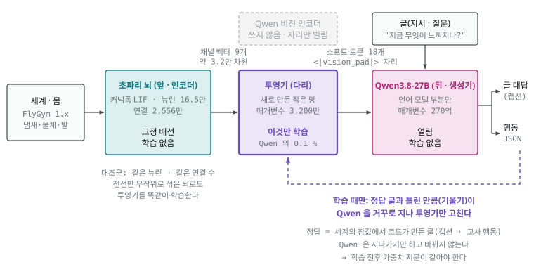

# 11. 구현 — 초파리 신경 신호를 Qwen 에 직접 넣기

> 2026-09-22. 01~10 이 조사와 설계였다면 이 문서는 **실제로 만들어 돌리고 있는 것**의 설명이다.
> 기계학습을 모르는 사람이 읽고 "무엇이 무엇을 배우는지"를 알 수 있게 썼다. 모르는 말은 끝의 [용어 풀이](#10-용어-풀이)에 있다.
> 코드: 이 저장소 `moai-echomind-fly-connectome` · 요구사항 R-3340(`docs/requirements/…3340…_req.md`) · 인수인계 `docs/requirements/echomind-fly-connectome-handoff.md`.
> 하는 순서는 [학습 안내서](../../training/README.md). 2026-09-23 의 다음 판(자료 v2 · 압축 관문 · 작은 투영기)은 이 문서 [8.6](#86-다음-판-준비-2026-09-23--코드는-끝났고-자료를-모으는-중) 과 [12](12-다음-학습-조사.md).

## 1. 한 줄로

**초파리 뇌가 만든 신경 신호를 Qwen 의 입력 자리에 직접 넣어서, Qwen 이 "초파리가 지금 무엇을 느끼는지" 말하고 초파리 몸을 움직이게 한다.**

요구자의 그림 그대로다.

| | 앞(인코더) | 뒤(생성기) | 나오는 것 |
|---|---|---|---|
| 흔한 이미지 생성 모델 | 글 → **LLM 텍스트 인코더** → 임베딩 | **디퓨전 모델** | 그림 |
| 이 프로젝트 | 세계 → **초파리 뇌** → 신경 신호 | **Qwen(LLM)** | 글 · 행동 |

이미지 생성은 글이 앞에서 그림 생성을 "조건 짓는다". 여기서는 **초파리 뇌 활동이 앞에서 LLM 의 생성을 조건 짓는다.**

## 2. 세 부품 — 무엇이 학습하고 무엇이 안 하나

| 부품 | 무엇 | 학습하나? |
|---|---|---|
| **초파리 뇌** | 수컷 초파리 커넥톰(MaleCNS) 16.5만 뉴런 · 2,556만 연결을 Shiu 2024 방정식으로 돌린 것 | **안 한다.** 배선은 진화와 발달이 만든 그대로 고정 |
| **투영기**(projector) | 초파리 신호 → Qwen 입력으로 바꾸는 **새로 만든 작은 번역기** | **이것만 학습한다**(매개변수 약 3,200만 · Qwen 의 0.1 %) |
| **Qwen3.8-27B** | 받아 둔 언어 모델(oMLX 폴더의 가중치를 우리 프로그램이 직접 읽음) | **안 한다.** 얼려 둔다 |

### 파인튜닝이 아니다

| | 파인튜닝(LoRA 등) | 이번 학습 |
|---|---|---|
| Qwen 가중치 | 바뀐다 | **그대로** — 학습 전후 가중치 지문을 찍어 같은지 확인한다 |
| 학습되는 곳 | Qwen 안(또는 덧붙인 층) | Qwen **바깥**의 투영기 |
| 떼어 내면 | — | Qwen 은 받아 둔 그대로. oMLX · Ollama 에서 쓰던 모델도 영향 없음 |

### 비전 쪽 학습도 아니다

Qwen3.8 은 원래 이미지를 읽을 수 있다: **이미지 → 비전 인코더 → 합치개 → `<|vision_pad|>` 자리 → 언어 모델.**
우리는 이 길에서 **비전 인코더와 합치개를 빼고**(아예 올리지 않는다) 같은 자리에
**초파리 신경 신호 → 투영기 → `<|vision_pad|>` 자리**를 넣는다. "이미지 자리에 초파리 신호"다.
이미지 읽는 LLM(LLaVA)이 처음 배울 때 이미지 인코더와 LLM 은 얼리고 **가운데 투영기만** 가르치는데, 그것과 같은 구조다.

## 3. 투영기는 무엇을 배우나

Qwen 은 초파리 뉴런의 발화를 한 번도 본 적이 없다. 번역기가 없으면 신호를 넣어도 뜻이 없다 —
학습 전에 넣어 보니 *"어둠 속에서 희미한 진동과 함께, 아무것도 없는 공허함 속에…"* 같은 말을 지어냈다.

투영기는 **"이런 뇌 활동이면 이런 상황"** 이라는 대응을 배운다. 방법은 단순하다.

1. 초파리 뇌 신호를 투영기에 넣고, 나온 것을 Qwen 입력 자리에 끼운다.
2. Qwen 이 쓴 글을 **정답 글**과 비교한다.
3. 틀린 만큼(기울기)을 Qwen 을 거꾸로 지나 투영기까지 보내서 **투영기만** 조금 고친다. Qwen 은 지나가기만 한다.
4. 수백 개 예시로 되풀이한다.

**정답 글은 사람이 쓰지 않는다.** 몸 시뮬레이터가 아는 세계의 참값(물체가 어디 있나 · 냄새 원이 어느 쪽인가)에서 코드가 만든다.

| 단계 | 질문(글) | 정답 예 |
|---|---|---|
| ① 정렬(캡션) | "지금 무엇이 느껴지나?" | `다가오는 물체: 왼쪽 · 중간 · 다가옴 / 먹이 냄새: 오른쪽 · 강함 / 다리 접촉: 6개 / 소리: 없음 / 암컷 대용 물체: 없음` |
| ② 행동 | "지금 어떻게 움직일까?" | `{"walk":1.0,"turn":"right","turn_strength":1.0,"stop":false,"groom":false}` |

행동 정답은 **교사 규칙**이 낸다 — 다가오는 물체가 위협(각 크기 20° 이상)이면 반대로 달리고, 아니면 냄새 쪽으로 가고, 먹이에 닿으면 멈춘다.
②단계에서는 캡션 예시를 30 % 섞는다. 같은 투영기로 **글 질문에는 글로, 행동 지시에는 JSON 으로** 답하게 하려는 것이다(요구자: *"일반 텍스트도 들어가서 · 초파리 신호도 들어가게"*).

## 4. 무엇을 넣나 — 채널 9개

요구자: *"초파리의 다양한 신호 데이터를 벡터화해서 LLM"* · *"성적인 전기신호 데이터까지도 · 시신경 · 촉각"*.

| 채널 | 뉴런(주석으로 고름) | 뉴런 수 |
|---|---|---|
| 시각 | 시각 투사 뉴런(시신경 → 중심뇌) | 6,675 |
| 촉각 | 다리 털 · 관절 · 날개 · 몸 기계감각 | 3,868 |
| 청각 | 존스턴 기관 청각 | 115 |
| 후각 | 후각 투사 뉴런 | 686 |
| 미각 | 미각 · 접촉 페로몬 | 1,428 |
| **구애 · 성 회로** | fru/dsx 발현 추정 · 암수 차이 뉴런 | 5,495 |
| 가치 | 버섯체 출력(좋다/나쁘다) | 97 |
| 몸 상태 | 상행 뉴런(신경삭 → 뇌) | 1,846 |
| 운동 | 하강 뉴런(뇌 → 신경삭) | 1,310 |
| **공간**(2026-09-23 `channels-v2` · 열째) | 중심복합체 나침반(EPG · PEN · PEG · Δ7) · 이동 벡터(PFN · hΔB) · 목표/조향(FC2 · PFL3) · 회전(HS · VS) — 단위는 구획을 지키는 인스턴스 | 656 |
| **후각 국소 뉴런 `smell_ln`**(2026-09-26 `channels-v3` · 열한째) | 안테나엽 국소 뉴런 4 종(`v2LN3A1_b` · `lLN2X02` · `lLN15` · `lLN2F_b`) — 그래프 선형 전파에서 같은 쪽 편향 0.40~0.48(투사 뉴런 0.08~0.15) · 약한 좌우 차를 투사 뉴런보다 잘 가른다(8.8 · [14](14-냄새-좌우-조사.md)) | 26 |

채널 벡터의 크기: v1 9 채널 31,950 차원 · v2 10 채널 33,402 차원 · v3 11 채널 33,450 차원(smell_ln 8 단위 · 48)(단위 수 × 구간 3 × 값 2). 표는 [학습 안내서 04장 5.1](../../training/04-감각-넣기와-신호-읽기.md).

**"전기 신호" = 발화 + 문턱 아래 막전위.** 300 ms 창을 100 ms 세 구간으로 나눠 뉴런 종류마다 ① 발화율 ② 평균 탈분극을 잰다.
이 모델은 쉬는 상태가 침묵이라 발화가 드물다. 청각 → 거대섬유처럼 **문턱 아래에만** 정보가 있는 경로가 있어서 막전위도 넣는다.

⚠️ **우리가 직접 자극하는 뉴런은 뺐다.** 감각 입구(다가옴 → LC/LPLC · 냄새 → ORN · 다리 접촉)와 명령용 하강 뉴런(DNp09 · DNa02)은 우리가 켜는 뉴런이다.
이것까지 넣으면 Qwen 이 초파리 뇌가 아니라 **우리 입력을 되읽게** 된다. 그래서 벡터에는 **회로를 거쳐 생긴 활동만** 남겼다.

## 5. 결정 하나가 흐르는 길 (300 ms)

1. **몸**(FlyGym 1.x · 별도 프로세스)이 지금 냄새 농도 · 다가오는 물체 · 다리 접촉을 알려 준다.
2. **감각 인코더**가 이를 감각 뉴런 발화율로 바꾼다 — 다가옴 → LC/LPLC 13종 · 식초 냄새 → ORN_DM1 · VA2 · 다리 접촉 → 그 다리의 촉각 뉴런.
3. **초파리 뇌**가 100 ms 돈다. 하강 뉴런이 낸 발화로 몸의 좌우 걸음 세기를 정하고, 몸이 100 ms 걷는다. 이것을 세 번 되풀이한다.
   거대섬유(DNp01)가 발화하면 그 구간은 멈춘다(반사 우선 — FlyGym 은 도약을 못 한다).
4. 300 ms 동안의 **채널 벡터 9개 → 투영기 → Qwen** 이 다음 행동 JSON 을 낸다.
5. 행동이 **하강 뉴런 목표 발화율**이 된다 — 걷기 = DNp09 · 왼쪽 회전 = 왼쪽 DNa02 · 오른쪽 회전 = 오른쪽 DNa02.

비실시간이다. Qwen 이 생각하는 동안 세계는 멈춰 기다린다.

## 6. "초파리 덕"인지 어떻게 가르나 — 대조군

같은 부품, 같은 뉴런 수, 같은 연결 수에 **전선만 무작위로 섞은 뇌**(섞은 배선)를 하나 더 둔다. 이 뇌의 신호로도 투영기를 **똑같이** 학습한다.
진짜 배선일 때만 잘 읽히고 잘 움직이면, 그 정보는 초파리 배선 덕이다.

성적표는 다섯 구성을 같은 씨앗(학습에 안 쓴 것) 10개로 돌린다.

| 구성 | 앞 | 뒤 | 가르는 것 |
|---|---|---|---|
| **vector**(본 설계) | 진짜 배선 → 벡터 → 투영기 | Qwen | — |
| text | 진짜 배선 → 글 요약 | Qwen | 벡터가 글보다 나은가 |
| no_circuit | 세계의 원시 숫자 | Qwen | 초파리 뇌를 거치는 것이 도움이 되나 |
| **rewired** | 섞은 배선 → 벡터 → 투영기(똑같이 학습) | Qwen | 초파리 배선 덕인가 |
| no_llm | 진짜 배선 → 하강 뉴런 그대로 | 없음 | Qwen 이 더한 것이 있나 |

**rewired 를 이기지 못하면 결과 보고에 "초파리 뇌"라는 말을 쓰지 않는다**(코드가 문구를 정한다).

(2026-09-23 부터) 섞은 뇌는 **하나가 아니라 여럿**이다 — 하나와 비교하면 우연히 약한/강한 것을 골랐을 수 있어서, 자료 v2 는 씨앗이 다른 섞은 뇌 다섯에 같은 입력을 넣고,
투영기도 최소 셋을 똑같이 학습한다. "이겼다"는 **섞은 뇌 전부보다 높고**, 에피소드 단위로 부호를 뒤집어 본 우연 확률이 5 % 미만일 때만이다(규칙 `stats-v2` · `scorecard-v2` — [학습 안내서 09장](../../training/09-평가와-대조군.md)).

## 7. 지금까지 확인한 것 (실측)

| 무엇 | 결과 |
|---|---|
| 시뮬레이터가 Shiu 원래 구현과 같은가 | Brian2 판과 **발화 한 개까지 같다** |
| 알려진 반사(다가옴 → 거대섬유) | 반응 확률 0.65 · 1.38 회 · 33.8 ms — 생리 기준 통과 · **섞은 배선은 0** |
| 광수용체로 빛을 넣으면 | 아무 데도 안 퍼진다(발화 0) → 시각 입구를 LC/LPLC 로 옮겼다 |
| Qwen 가중치를 직접 읽나 | 8 초 · 28.6 GB · 토큰 대신 같은 임베딩을 넣으면 **결과가 완전히 같다** → 신호를 끼울 수 있다 |
| Qwen 이 도구로 실험을 설계하나 | 7 턴 · 실험 3 번 · 인용한 실행 기록 전부 실재(해석에는 틀린 곳이 있었다) |
| **초파리 배선이 냄새 신호를 퍼뜨리나** | 진짜 배선: 후각 투사 뉴런 합 3.2~3.8만 Hz · 구애/성 0.9~1.1만 · 몸 · 운동까지 / **섞은 배선: 거의 0** |
| 닫힌 고리가 도나 | 교사 규칙으로 먹이까지 2.7~3.0 초 만에 도착(시험 에피소드 4/4) |

## 8. 지금 돌고 있는 것과 시간

| 순서 | 무엇 | 시간(추정) | 메모리 |
|---|---|---|---|
| 1 | ✅ 학습 자료 모으기 — 교사가 몸을 몰고 진짜·섞은 배선 뇌 둘에 같은 입력. **학습용 581 개**(씨앗 0~59 · 교사 60/60 도착 · 다가오는 물체 39 번 중 부딪힘 1) · **평가용 105 개**(씨앗 1000~1011 · 학습에 안 씀) | 25 분(일꾼 3) | 가벼움 |
| 2 | 투영기 학습 — 진짜 배선 · 섞은 배선 각각(① 캡션 2 바퀴 ② 행동 + 캡션 섞기 1 바퀴) | 한쪽 약 9 시간 | **최대 약 32 GB**(고친 뒤) |
| 3 | 캡션 평가 — 학습에 안 쓴 씨앗으로 칸별 정확도(최빈값 기준선과 나란히) | 약 30 분 | 29 GB |
| 4 | 성적표 — 다섯 구성 × 10 씨앗 | 약 2~3 시간 | 29 GB |

▶ 2~4 는 2026-09-22 07:05 에 시작했다가 **20:0x 에 멈췄다**(요구자 "지금 멈춤"). 진짜 배선 쪽 **캡션 단계는 끝나 저장됐다**
(검증 캡션 손실 3.36 → 0.11 — 낮을수록 정답 글에 가깝다). 행동 단계 도중이었고 섞은 배선 · 평가 · 성적표는 아직이다.
**22:07 에 다시 시작했다**(요구자 "학습 다시 돌려"). 진짜 배선은 저장된 캡션 단계에서 이어 행동 단계만 돌고,
섞은 배선은 처음부터 돈다. 끝나면 결과를 이 문서의 새 장으로 덧붙인다.

> 이어 가느라 바꾼 것 하나 — 학습 속도를 조절하는 부품(옵티마이저)의 기억은 저장본에 없다. 그래서 **두 뇌 모두**
> 행동 단계를 새 옵티마이저로 시작하게 맞췄다(규칙 판 `train-v2`). 대조군은 절차가 똑같아야 하기 때문이다.
> 대가: 행동 단계 첫 100 걸음의 손실이 이전 방식보다 높게 시작한다(0.63 → 0.33 으로 내려오는 중 · 이전 방식은 0.21 → 0.14).

**왜 멈췄고 무엇을 고쳤나** — 학습 프로그램이 13 시간 동안 메모리를 103 GB 까지 먹어 맥 전체가 스왑(디스크를 메모리 대신 쓰기)으로 느려졌다.
원인은 둘이었다.

| 원인 | 쉽게 말하면 | 고친 것 | 결과 |
|---|---|---|---|
| ① 걸음 사이 캐시 | 한 걸음을 마친 뒤 쓴 메모리를 "다시 쓸지 몰라" 쥐고 있었다(약 75 GB) | 걸음마다 내려놓고 상한을 둔다 · 도는 중에도 메모리를 보다 넘치면 저장하고 멈춘다 | 캐시 75 GB → 0.2 GB |
| ② 한 걸음 안 최대치 | Qwen 을 거꾸로 지나며 틀린 만큼을 계산할 때, 64 층 전부의 중간 계산을 **한꺼번에** 들고 있었다(글자 하나당 약 0.3 GB) | **한 층씩** 거꾸로 계산하고 그 층 것을 내려놓은 뒤 다음 층으로 | 최대 102 GB → **32 GB** |

②는 계산 결과(투영기를 고치는 방향)가 한꺼번에 할 때와 **같다** — 작은 가짜 모델로 둘을 나란히 돌려 확인했다.
그 대신 한 걸음이 조금 느려졌다(13~23 초).

**학습 자료는 다음에도 쓸 수 있게 묶어 두었다** — `GitHub/moai-echomind-fly-connectome/data/datasets/fly-loop-v1/`(75 MB · git 밖 로컬).

| 들어 있는 것 | |
|---|---|
| `train/` · `eval/` | 진짜 배선 뇌 · 섞은 배선 뇌의 채널 벡터(`features-real.npz` · `features-rewired.npz`) · 결정마다 참값 · 캡션 · 교사 행동(`samples.jsonl`) · 에피소드 결과 |
| `README.md` | 자료 카드 — 무엇 · 어떻게 만들었나(코드 커밋 `4ac4635` · 설정 판) · 불러오는 법 · 다시 만드는 법 |
| `SHA256SUMS` | 체크섬 — `fly-connectome dataset verify fly-loop-v1` 이 "온전"이면 그대로다 |

형식 설명은 저장소의 `docs/datasets.md`(git 에 있음). 설정이 바뀌면 새 이름(`fly-loop-v2` …)으로 따로 묶는다.

학습이 처음에 90 GB 를 먹어 "메모리 여유 40 %" 규칙을 지킬 수 없었다. 요구자가 이 학습에만 풀었다(2026-09-22) — **시작 전 여유 80 % 이상**일 때만 시작하고, 도는 동안 다른 무거운 실행은 잠금으로 막는다. 고친 뒤(32 GB)에도 이 문턱은 그대로 둔다.

## 8.5 결과 (2026-09-23 04:49 · 전부 끝남)

먼저 결론부터. **이번 판으로는 "초파리 뇌 덕분에 됐다"고 말할 수 없다.** 대조군(전선만 무작위로 섞은 뇌)을
이기지 못했기 때문이다. 처음에 그렇게 정해 두었고(6장), 성적표 파일에도 그대로 적혀 있다.

### 성적표 — 같은 열 개 상황을 다섯 가지 방식으로

| 방식 | Qwen 이 받는 것 | 먹이 도착 | 끝났을 때 먹이까지 |
|---|---|---|---|
| **벡터** (우리가 만든 것) | 초파리 회로 → 투영기 → Qwen | **2/10** | 41 mm |
| 글 | 초파리 회로를 문장으로 요약 | 0/10 | 53 mm |
| **회로 없음** | 세계의 숫자를 그대로 | **9/10** | 5 mm |
| **섞은 배선** (대조군) | 섞은 회로 → 투영기 → Qwen | **2/10** | 39 mm |
| LLM 없음 | — (가만히 있음) | 0/10 | 26 mm |

형식이 틀린 답은 다섯 방식 모두 0 건이었다. 캡션(지금 무엇이 느껴지나)을 맞히는 정확도도 네 저장본 모두
**"제일 흔한 답으로 찍기"와 같은 수준**이었다.

### 그럼 무엇이 문제인가 — 세 갈래로 갈라 봤다

| 물음 | 답 | 근거 |
|---|---|---|
| Qwen 이 이 과제를 못 하나? | **아니다.** 숫자를 그대로 주면 9/10 으로 찾아간다 | 위 표 "회로 없음" |
| 초파리 신호에 정보가 없나? | **있다.** Qwen 없이 신호만으로도 맞힌다 | 아래 표 |
| 그럼? | **사이의 다리가 묻는다** — 신호를 Qwen 이 읽을 형태로 못 바꾸고 있다 | 둘을 합치면 남는 설명 |

Qwen 을 빼고, 초파리 신호 벡터만으로 같은 칸을 맞혀 본 결과다(선형 분류기 · CPU 14 초):

| 어떤 신호로 무엇을 맞히나 | 진짜 배선 | 섞은 배선 | 그냥 찍기 |
|---|---|---|---|
| 시각 → 물체가 다가오나 | **0.81** | 0.74 | 0.67 |
| 시각 → 물체가 어느 쪽인가 | **0.74** | 0.59 | 0.67 |
| 몸 → 다리가 몇 개 닿았나 | **0.59** | 0.42 | 0.33 |
| 후각 → 냄새가 어느 쪽인가 | 0.46 | 0.47 | 0.54 |

여기서는 **진짜 배선이 섞은 배선보다 높다** — 우리가 보고 싶었던 차이가 신호 단계에서는 보인다.
(2026-09-23 다시 재어 같은 값을 파일로 남겼다 — `runs/linear-probe-20260923-094302.json`. 시각은 물체의 거리 · 움직임도 진짜 배선이 높다 · 0.77 / 0.58 · 0.78 / 0.57.
하는 순서와 전체 표는 [학습 안내서 10장](../../training/10-학습-기록과-다음.md).)
그런데 아홉 채널 3만 2천 개 숫자를 **한꺼번에** 넣으면 그 차이가 사라진다(둘 다 찍기 수준).
지금 투영기는 표본 581 개에 견주어 매개변수가 3,190 만 개다 — 재료에 비해 다리가 너무 크다.

### 그래서 다음에 해볼 것 (요구자와 정하고 나서)

1. **넣는 숫자를 줄인다** — 채널마다 요약해서(예: 수십 개로) 넣는다. 지금은 3만 2천 개를 통째로 민다.
2. **정답 글의 틀을 덜 세게 만든다** — 캡션은 틀이 고정돼 있어, 배우는 힘의 대부분이 틀 글자를 외우는 데 쓰인다.
3. **재료를 늘린다** — 581 개는 적다.
4. **냄새 방향은 따로 본다** — 두 뇌 모두 못 읽는다. 좌우 차이가 벡터에 남는지부터 확인한다.

→ 이 넷은 2026-09-23 요구사항 **R-7469** 로 정의됐고(조사는 [12](12-다음-학습-조사.md)), 같은 날 코드가 끝났다 — 다음 절.

## 8.6 다음 판 준비 (2026-09-23 · 코드는 끝났고 자료를 모으는 중)

위 넷에 "판정을 믿을 수 있게"와 "3차원"을 더해 여섯 가지를 만들었다. 전부 코드와 규칙(판 번호)이 먼저이고, 실행은 새 자료가 모인 뒤다 —
같은 날 저녁 자료 · 판정 · 관문 · 봉우리 검사까지 끝났고, 남은 것은 Qwen 학습(작은 측정 → 요구자 확인)이다.

| 무엇 | 어떻게 | 판 · 명령 | 지금 |
|---|---|---|---|
| **판정을 믿을 수 있게** | 섞은 뇌 여럿(앙상블)과 비교 · 에피소드 단위로 부호를 뒤집어 우연 확률을 재고 · 여러 칸을 볼 때는 보정(Holm) · 정확도는 에피소드 부트스트랩 구간 | `stats-v2` · `linear-probe` | ✅ 옛 자료로 먼저 돌려 봄 — 시각 → 물체 거리 · 움직임 **두 칸 통과**(0.771/0.581 · 0.781/0.571 · 보정 p 0.047). 물체 쪽(p 0.025) · 다리(p 0.005)는 보정 뒤 탈락 → **새 자료(섞은 뇌 5 · 40 에피소드)로 다시: 통과 8 칸** — 시각 네 칸(0.85/0.80/0.77/0.83 · 섞은 0.62~0.73 · 찍기 0.73) · 다리 접촉 네 채널(몸 0.62 · 촉각 0.57 · 구애 0.56 · 미각 0.51 · 섞은 약 0.46 · 찍기 0.36) · 전부 섞은 뇌 다섯 모두보다 위 |
| **냄새 좌우** | 그래프에서 재니 후각 수용 뉴런 시냅스가 **같은 쪽 51.7 % · 반대쪽 47.7 %** — 양쪽으로 반반 가서 개수로는 좌우가 지워진다. 생체는 같은 쪽 가지가 스파이크마다 약 40 % 더 방출(Gaudry 2013) → 그 규칙을 넣었다 | `sim-v2`(같은 쪽 × 1.4) · `inspect laterality` | ⚠️ 그래도 **못 읽는다** — 한 결정 창에서는 두 더듬이 차(중앙 4.4 %)가 발화 잡음보다 작다(투사 뉴런 좌우 부호 0.508 · v1 · v2 같음). 냄새 쪽 칸은 판정에서 뺐다. 시간을 두고 읽는 방식은 후보 |
| **3차원 입력** | 물체에 **고도**(−30~+60°) · 시각 투사 뉴런마다 시야 **고도**를 연결 지도로 계산(입력 기둥 뉴런 좌표의 시냅스 가중 평균 · 위아래 축은 등 가장자리 광수용체와 HS 뉴런으로 확인 · 앞뒤 축은 미확정) · 몸 자세 · 위치 · 방향 기록 · **공간 채널**(중심복합체) | `task-v2` · `retino-v1` · `channels-v2` · `retinotopy build` · `inspect bump` | ✅ 고도 4,096 개(LC4 · LPLC2 · LC16 · LPLC1 전부 · **LC17 은 353 중 9** — 빼지 않고 조율 없이 켠다) · 지형은 미룸 · 같은 날 오후 눈의 앞뒤 축을 확정해 방위까지(`retino-v2` · [13 §4](13-회로-학습-설계-조사.md) · 새 자료는 고도만 쓴 v1) · ❌ **나침반 봉우리 검사 실패** — 진짜 배선의 EPG 가 3,297 결정 동안 한 번도 발화하지 않았다(예상된 한계 · 기록하고 회로 학습의 목표로 넘김) |
| **재료 늘리기** | 학습 60 → **300** 에피소드 · 평가 12 → **40** · 섞은 뇌 **다섯**에 같은 입력 · 감각 입력도 저장 | `collect --rewired-seeds 0-4` · `fly-loop-v2` | ✅ 학습 2,921 · 평가 376 결정(11:21 → 19:33 · 8.2 시간 · 1.1 GB · 교사 도착 340/340) |
| **넣는 숫자 줄이기** | 채널마다 주성분(PCA)으로 16~64 차원 · 줄인 벡터로도 판정을 통과한 채널만 다음으로(관문) · 섞은 뇌마다 같은 규칙으로 따로 | `compress-v2` · `compress fit` · `gate` | ✅ 실행 — 처음 규칙(분산 0.95)은 진짜 뇌의 시각을 16 · 섞은 뇌를 64 차원으로 줄여 **절차가 달라지고** 물체 정보가 잘렸다(0.85 → 0.74) → 모든 뇌 · 채널 64 로 고정(결과 뒤 고침 · 까닭 기록) → 통과 **시각 · 촉각 · 미각 · 몸** |
| **작은 투영기 · 틀 덜 세게** | 통과 채널의 압축 벡터 → 채널당 **선형 토큰 하나**(3,187만 → 수십만) · 손실은 **칸 값 글자 1 · 틀 글자 0.1**(0 이 아닌 까닭: 서식을 배울 곳이 정답뿐) · 섞은 뇌 셋도 똑같이 | `train-v4` · `scorecard-v2` | ✅ 끝 — 입력 크기를 뇌마다 맞춘 `train-v5`(compress-v3)로 진짜 + 섞은 셋 학습 · 채점 평가 · 성적표 → **결과는 8.7** |

순서와 결과 파일은 [학습 안내서 10장 4절](../../training/10-학습-기록과-다음.md). 이 판에서도 섞은 뇌 앙상블을 못 이기면 8.5 와 같은 문구로 적는다.

## 8.7 두 번째 판 결과 — train-v5 (2026-09-25 · 전부 끝남)

결론부터. **캡션에서는 처음으로 진짜 배선이 섞은 배선 셋을 이겼다. 행동(성적표)은 여전히 못 이겼다** —
그래서 성적표 쪽 결과로는 이번에도 "초파리 뇌"라는 말을 쓰지 않는다(R 2.0-6 · 두 번째 발동).

### 캡션 — 지금 무엇이 느껴지나 (채점 평가 · 평가 376 결정 / 40 에피소드)

판정 칸은 평가 전에 정했다. 통과 = 진짜가 섞은 배선 셋 모두 위 · 에피소드 부호 뒤집기 검정(Holm 보정) < 0.05 · 찍기보다 높음.

| 칸 | 진짜 배선 | 섞은 배선 s0 · s1 · s2 | 그냥 찍기 | 판정 |
|---|---|---|---|---|
| 물체가 있나 | **0.806** | 0.729 · 0.729 · 0.739 | 0.726 | ✅ |
| 다리가 몇 개 닿았나 | **0.574** | 0.505 · 0.497 · 0.391 | 0.362 | ✅ |
| 물체가 어느 쪽인가 | 0.573 | 0.466 · 0.340 · 0.544 | 0.505 | ✅ 규칙상 · 찍기 대비 p 0.14 → **찍기와 구별 안 됨** |
| 물체가 움직이나 | 0.524 | 0.524 · 0.524 · 0.563 | 0.524 | ❌ |

8.5 에서 "네 저장본 모두 찍기 수준"이던 캡션이 이번에는 두 칸에서 섞은 배선을 앞섰다 — 넣는 숫자를 줄이고(채널당 64 · 뇌마다 같은 크기)
틀 글자를 덜 세게 한 것이 신호 단계의 차이를 Qwen 쪽까지 옮겼다. 캡션만 배운 단계의 저장본이 최종본보다 높다(물체 있음 0.851) —
행동을 배우는 단계가 캡션을 조금 깎는다.

### 성적표 — 먹이 찾기 (씨앗 2000~2039 · 40 상황 × 7 방식)

| 방식 | 먹이 도착 | 끝났을 때 먹이까지 |
|---|---|---|
| **벡터** (진짜 배선) | **0.075** | 47.5 mm |
| 섞은 배선 s0 · s1 · s2 | 0.075 · 0.025 · 0.075 | 50.7 · 53.3 · 58.2 mm |
| 글 | 0.075 | 43.2 mm |
| **회로 없음** | **0.95** | 2.0 mm |
| LLM 없음 | 0.0 | 25.2 mm |

진짜 배선은 섞은 배선 셋 가운데 가운데쯤이고(부호 뒤집기 p 0.42) → **섞은 배선 대조를 이기지 못했다.**
파일: `runs/scorecard-20260925-175025/scorecard.json`(sha256 `4bbd8625b19836b1`) · 캡션 `runs/caption-judge-train-v5-final.json`.

### 그럼 이번엔 무엇이 문제인가

| 물음 | 답 |
|---|---|
| Qwen 이 과제를 못 하나? | **아니다** — 숫자를 그대로 주면 0.95 |
| 신호가 Qwen 까지 가나? | **이번엔 간다** — 캡션에서 진짜 배선이 물체 있음 · 다리를 섞은 배선보다 잘 읽는다 |
| 그럼? | 먹이 찾기에 필요한 **냄새 좌우**가 어느 뇌 신호에도 없다(8.6 "냄새 좌우" 줄 · F-003) — 그래서 행동은 모든 뇌가 같이 못 한다 |

→ **다음 병목 = 냄새 좌우 정보.** 순서와 대장은 [학습 안내서 10장 2.4 · 2.5](../../training/10-학습-기록과-다음.md).

## 8.8 냄새 좌우 — 센서부터 과제까지 (2026-09-26 · 연구 노트 14 M0~M4)

8.7 의 다음 병목(냄새 좌우)을 조사([14](14-냄새-좌우-조사.md))대로 차례로 쟀다. 수치는 R-7469 F-003 인수 기준에서 그대로 옮겼다.

| 단계 | 무엇을 | 결과 |
|---|---|---|
| **M0 센서** | 냄새 센서 번호 | `sensors: {L: 0, R: 1}` 은 더듬이가 아니라 **작은턱수염**이었다 → `task-v2.1` 에서 더듬이(2 · 3)로. 좌우 차는 약 1/3.5 로 줄어든다(원천 25 mm · 옆 90° 에서 4.8 % → 1.37 %). **자료 `fly-loop-v2` 와 v5 결과(8.7)는 작은턱수염 기준**이다 |
| M2 여러 창 | 기존 자료로 직전 결정 1 · 3 · 5 · 10 개 누적 · 시간 차 | 누적해도 오르지 않는다(진짜 0.524~0.543 · 찍기 0.556). 규칙상 통과 1 칸도 찍기 대비 p 0.166 → 구별 안 됨 |
| **M1 양성 대조** | 한쪽 ORN 만 100 % 구동 | 투사 뉴런 부호 정답률 **1.000**(재배선 0.358 · 침묵) → **회로는 좌우를 나른다.** 그러나 **차가 작다** — 좌우 차 0.35~1.05 Hz(바탕 약 26 Hz 의 **2~4 %**). **조향 하강 뉴런 DNa02 는 0 Hz** — 냄새가 조향 출력까지 닿지 않는다 |
| **M1b 약한 좌우 차** | 좌우 차 2~20 % × 창 0.3~3 s | 입력(ORN)에는 2 % 부터 정보가 있는데 **투사 뉴런에서 거의 다 사라진다**(20 % · 3 s 에서야 문턱). **LN4(국소 뉴런 4 종)는 5~10 % · 1 s 이상에서 가른다** |
| M3 LN 채널 | `channels-v3`(`smell_ln`) · 자료 v2 를 뇌만 재생(`fly-loop-v2-ln`) | LN4 최고 0.588 · 투사 뉴런 0.574 · 찍기 0.556 — 찍기 대비 p ≥ 0.18 → 구별 안 됨. 옛 과제에서는 파리가 결정(0.3 s)마다 돌아 **1 s 이상 일정한 좌우 차 구간이 거의 없다** |
| **M4 작은 시험** | `task-v4`(처음 4 결정 몸 세움 = 냄새 맡기 구간 · 먹이 4~7 mm · 옆 방위 45~90°) · 학습 60 + 평가 40 · 진짜 + 재배선 s0 | **처음으로 닫힌 고리 냄새 쪽이 찍기와 구별된다** — 전체 · LN4 10 누적 **0.682**(재배선 0.367 · 찍기 0.485 · 찍기 대비 p 0.006 · Holm 0.001) · 냄새 맡기 구간 · LN4 2 누적 0.650(찍기 0.500 · p 0.031 · Holm 0.065 경계) · 투사 뉴런은 불통 |

| **M4 전체** | `fly-loop-v4`(학습 200 · 평가 200 에피소드 · 재배선 s0~s2) · `stats-v3`(결과 전에 정함) | 냄새 맡기 구간 · LN4 **4 결정 누적(1.2 s) 0.725**(재배선 평균 0.525 · 찍기 0.490 · 찍기 대비 p < 0.001 · Holm 0.001) · 1 결정 0.637 · 전체 5 누적 + 시간 차 0.694 · 한 창 선형 검사 `smell_ln → 냄새 쪽` 0.554(Holm 0.006) · 투사 뉴런은 불통(0.537~0.562 · p ≥ 0.066) → **F-003 성공 기준 충족(task-v4 · LN4)** |

한계: 과제를 바꿨다(냄새 맡기 구간은 몸을 세워 둔 절차). 재배선의 후각은 거의 침묵이라 "재배선보다 높음"은 쉬운 비교 — 그래서 찍기 대비 p 로 함께 판정했다.
이것은 **신호 단계(선형 검사)** 결과다 — 성적표(행동)는 아직이므로 R 2.0-6 문구 규칙은 그대로다(8.7).

## 8.9 세 번째 판 결과 — train-v6 (2026-09-27 → 09-29)

8.8 에서 냄새 쪽이 신호 단계를 통과해, 같은 자료(`fly-loop-v4` · task-v4)로 투영기를 다시 학습했다. 입력은 관문을 넘은 **시각 · 후각 국소 뉴런(smell_ln) · 공간** 셋이다
(v5 의 몸 · 촉각 · 미각은 이번 자료에서 다리 칸이 관문을 못 넘어 빠졌다 — 그래서 다리 칸에는 입력이 없다).
결론부터: **캡션에서는 냄새 쪽이 처음 통과했다. 행동(성적표)은 이번에도 섞은 배선을 못 이겼다** — "초파리 뇌"라는 말을 쓰지 않는다(R 2.0-6 · 세 번째 발동).

### 캡션 — 채점 평가 1,708 표본 · 200 에피소드 · stats-v3(결과 전에 정함)

| 칸 | 진짜 배선(최종) | 섞은 배선 s0 · s1 · s2 | 그냥 찍기 | 판정 | 캡션 단계본 진짜 |
|---|---|---|---|---|---|
| 물체가 있나 | **0.735** | 0.672 · 0.703 · 0.683 | 0.667 | ✅ | 0.738 ✅ |
| **냄새가 어느 쪽인가** | **0.530** | 0.476 · 0.506 · 0.502 | 0.461 | ✅ Holm 0.022 | **0.577** ✅ Holm < 0.001 |
| 물체가 움직이나 | 0.680 | 0.671 · 0.663 · 0.673 | 0.671 | ❌ | 0.687 ✅ |
| 물체가 어느 쪽인가 | 0.506 | 0.464 · 0.517 · 0.497 | 0.506 | ❌ | 0.524 ❌ |
| 다리가 몇 개 닿았나 | 0.716 | 0.614 · 0.731 · 0.721 | 0.713 | ❌ 입력 없음(예상) | 0.724 ❌ |

v5(8.7)는 냄새 쪽을 판정조차 못 했다 — 이번에 처음 **Qwen 을 거친 경로에서도** 냄새 쪽이 섞은 배선 셋과 찍기를 넘었다. 행동 단계가 캡션을 또 깎는다(냄새 쪽 0.577 → 0.530 · 움직임 통과 → 불통).
파일: `runs/caption-judge-train-v6-final.json`(sha256 `c999c6766e9cda7e`) · `-stage1-caption.json`(`c647768f86b70752`).

### 성적표 — 먹이 찾기 (task-v4 · 씨앗 2000~2039 · 40 상황 × 7 방식)

| 방식 | 먹이 도착 | 끝났을 때 먹이까지 | 교사가 돌라 한 결정에서 같은 쪽 / 반대쪽 |
|---|---|---|---|
| **벡터** (진짜 배선) | **0.350** | 6.3 mm | 0.558 / 0.360 |
| 섞은 배선 s0 · s1 · s2 | 0.200 · **0.375** · 0.300 | 19.5 · 8.3 · 9.2 mm | 0.508 / 0.491 · 0.580 / 0.372 · 0.556 / 0.438 |
| 글 | 0.000 | 47.2 mm | 0.097 / 0.050 |
| 회로 없음(더듬이 원시 값 숫자) | 0.325 | 19.6 mm | 0.690 / 0.069 |
| LLM 없음 | 0.000 | 5.6 mm | — |

진짜 배선은 섞은 배선 s0 · s2 와 회로 없음보다 높지만 **s1(0.375)을 넘지 못했다**(순위 67 % · 부호 뒤집기 p 0.29) → **섞은 배선 대조를 이기지 못했다.**
결정 기록(scorecard-v3)으로 보면 s0 은 도는 쪽이 동전 던지기(0.508)인데 진짜 · s1 · s2 는 0.56~0.58 로 비슷하다 — 캡션의 냄새 쪽 차이가 행동에서 가를 만큼 크지 않다.
회로 없음이 v5 의 0.95 에서 0.325 로 떨어졌다 — 더듬이 기준 과제는 Qwen 에게도 어렵다. **과제가 달라 v5 와 숫자를 바로 비교하지 않는다.**
파일: `runs/scorecard-20260928-124155/scorecard.json`(sha256 `c889e93a44fb2a17`). 대장은 [학습 안내서 10장 2.6 · 2.7](../../training/10-학습-기록과-다음.md).

## 9. 정직하게 적어 둘 한계

- **행동을 정하는 판단은 여전히 Qwen(과 교사 규칙)의 것이다**(07 의 판정). 초파리 뇌는 감각을 처리해 신호를 만드는 인코더 자리다.
- **교사 규칙이 정답을 정한다.** 그래서 섞은 배선 대조군이 필요하다.
- 걷기 리듬은 초파리 회로가 아니라 **FlyGym 보행 제어기**가 만든다(하강 뉴런 발화 → 좌우 걸음 세기만 초파리 쪽).
- 시각은 광수용체가 아니라 **LC/LPLC 에 계산한 특징**을 넣는다(침묵 LIF 는 빛의 이중 반전을 못 낸다).
- 청각 → 거대섬유는 이 모델에서 **발화해 버린다**(생체는 문턱 아래) — 전기+화학 혼합 시냅스를 화학으로만 둔 탓.
- Qwen 가중치는 공식판이 아니라 **Uncensored 파생판**(요구자 선택)이다.
- 다가오는 물체는 몸과 부딪치지 않는 **계산된 물체**다(방위 · 크기 · 확대 속도 · 2026-09-23 부터 고도). 지형은 평지다.
- 냄새의 **좌우**는 이 모델 · 이 창 길이로는 읽히지 않는다(8.6) — 판정에서 뺐다.
- 시각 투사 뉴런의 시야 자리는 **고도만** 계산했고 앞뒤(방위) 축은 확정하지 못했다 · LC17 은 대부분 좌표가 없다.
- 섞은 뇌 앙상블 판정은 자료 v2 부터다 — 지금까지 결과(8.5)는 섞은 뇌 **하나**와의 비교다.

## 10. 용어 풀이

| 말 | 뜻 |
|---|---|
| 커넥톰 | 뉴런 사이 연결 지도. 누가 누구에게 시냅스 몇 개로 이어졌나 |
| LIF | 뉴런을 "전압이 쌓이다 문턱을 넘으면 한 번 발화"로 줄인 방정식 |
| 발화 · 막전위 | 뉴런이 신호를 내보내는 순간 · 뉴런 안의 전압(문턱 아래에서도 움직인다) |
| 임베딩 | LLM 이 글자를 받아들이는 숫자 벡터. Qwen 은 토큰 하나를 5,120 개 숫자로 받는다 |
| 소프트 토큰 | 글자가 아닌데 임베딩 자리에 들어가는 벡터 — 여기서는 투영기가 만든 초파리 신호 |
| 투영기 | 한 종류의 벡터(초파리 신호)를 다른 공간(Qwen 임베딩)으로 옮기는 작은 신경망 |
| 기울기 · 역전파 | 정답과 틀린 만큼을 거꾸로 보내 "어느 쪽으로 얼마나 고치면 되나"를 계산하는 것 |
| 얼림 | 학습 중에도 그 부품의 가중치를 바꾸지 않는 것 |
| 파인튜닝 | 이미 학습된 모델의 가중치 자체를 더 학습시키는 것 — **이번에는 하지 않는다** |
| 캡션 | 상황을 적은 짧은 글. 여기서는 "다가오는 물체: … / 먹이 냄새: …" 서식 |
| 교사 규칙 | 세계의 참값을 아는 코드가 정답 행동을 정하는 규칙 |
| 섞은 배선 | 연결 수는 그대로 두고 연결 상대만 무작위로 섞은 뇌 — "배선 덕인가"를 가르는 대조군 |
